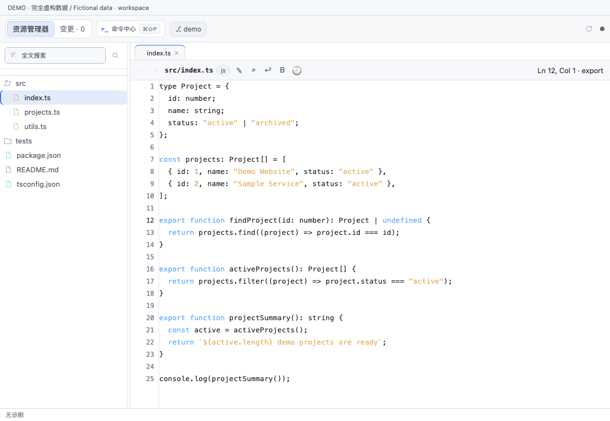
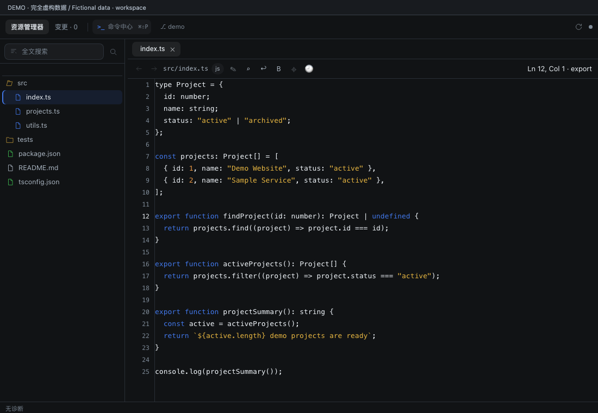
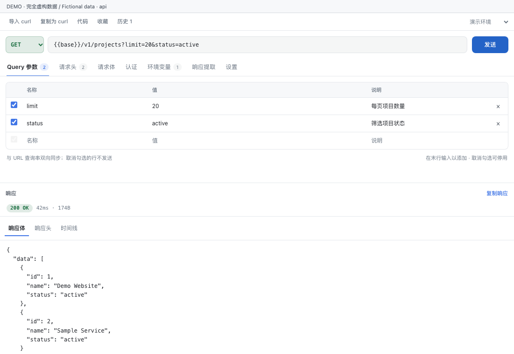
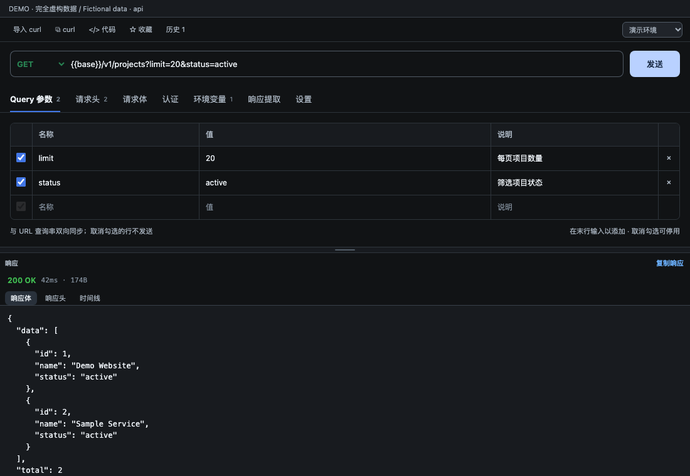
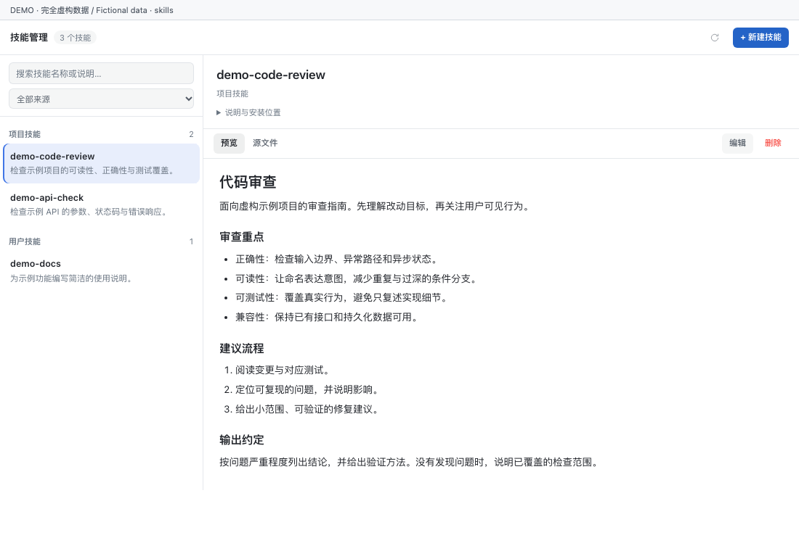
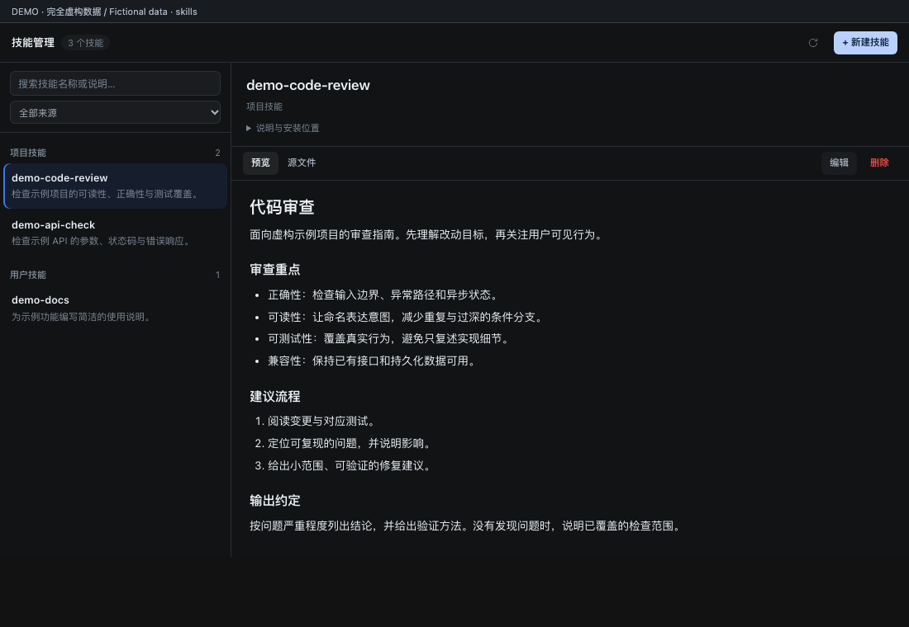
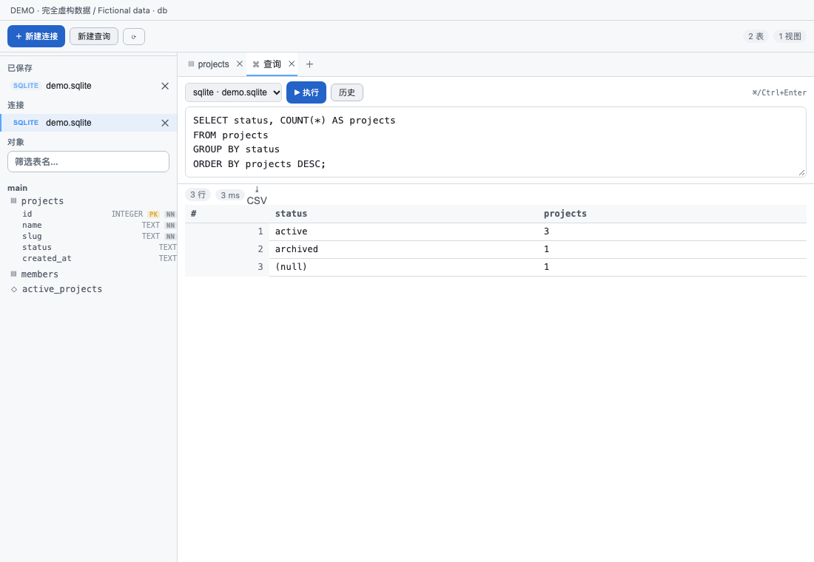
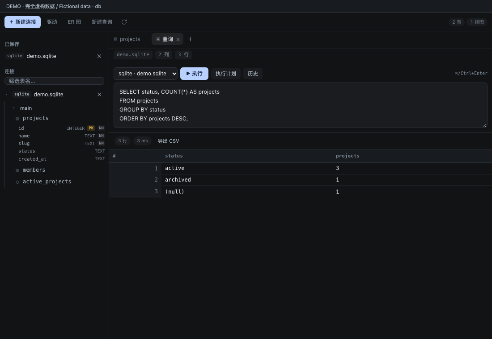
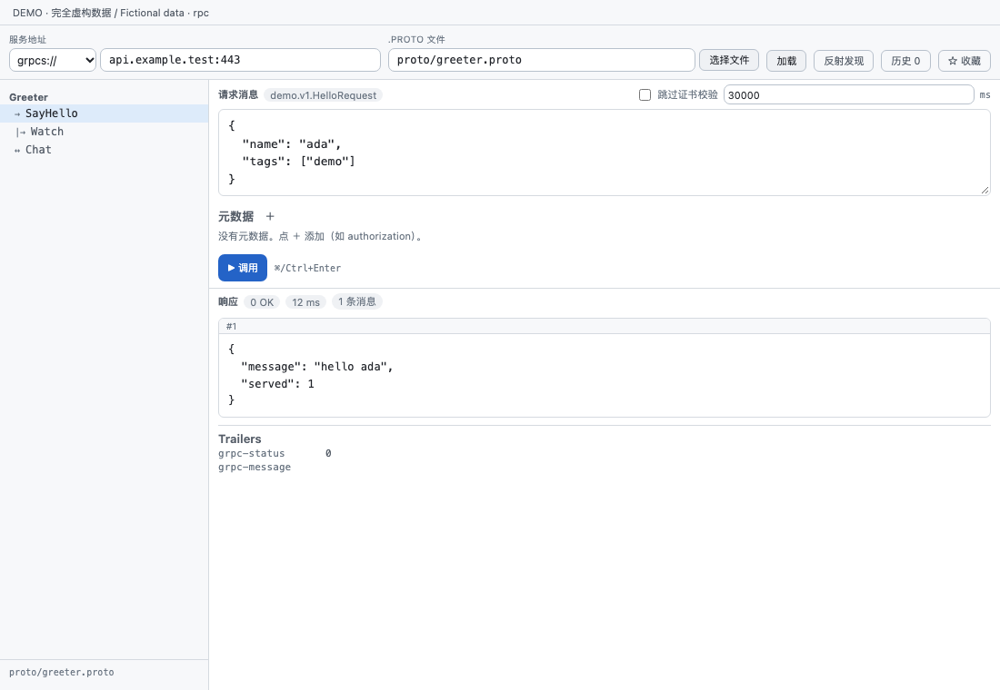
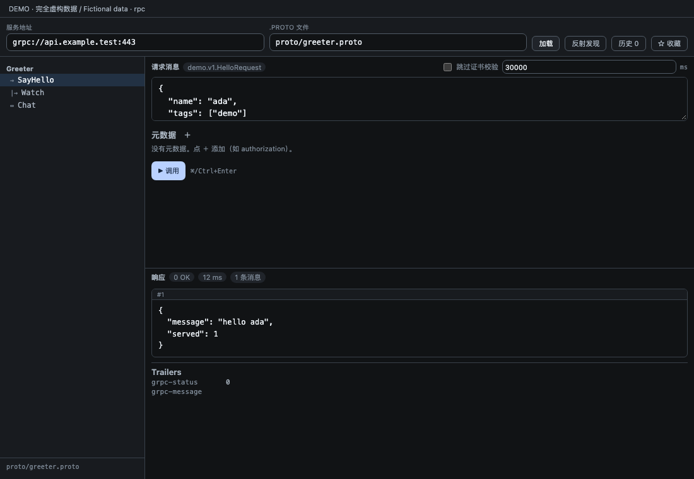

# dsh-plugin-kit

English | [简体中文](README.md)

**Browse code, review changes, test APIs, and manage skills while chatting with your Agent in DeepSeek Harness (DSH).**

`dsh-plugin-kit` places tool entry points in the DSH left navigation, alongside Plugins and Automations. Choose **Dev Workspace, Request Workbench (HTTP + gRPC), Skills Manager**, or an available browser/terminal entry to open it in the current session’s right workspace while keeping the conversation in the center. The right Start page is an empty-workspace guide rather than a duplicate launcher.

Dev Workspace combines file exploration, editing, search, symbols, Git review and a terminal entry beside the workspace, with a keyboard-first Command Center (`⌘/Ctrl+Shift+P`). All surfaces support DSH light and dark themes.

## Screenshots and privacy

The README does not display real workspace or user-session screenshots, to avoid exposing usernames, local paths, project files, internal endpoints, cookies, tokens, or other personal information. UI examples use entirely fictional data and are reviewed before publication.

## UI previews — fictional data

These screenshots render the current plugin components with fictional fixtures and are marked **DEMO / Fictional data**. They are not screenshots of a real workspace or authenticated session. API examples use the reserved `example.test` domain; files, code and skills are sample content without real usernames, personal paths, internal endpoints or credentials. The previews show the Chinese UI.

| Feature | Light theme | Dark theme |
| --- | --- | --- |
| Dev Workspace |  |  |
| API Tester |  |  |
| Skills Manager |  |  |
| Database |  |  |
| RPC |  |  |

[UI system / 主题与布局约定](docs/ui-system.md)

## What does this plugin do?

| Entry location | Tool | What you can do |
| --- | --- | --- |
| Left navigation | **Dev Workspace** | Unified file explorer, code editor, search, LSP navigation, and Git changes workbench. |
| Left navigation | **Request Workbench** | HTTP and gRPC in one tab, sharing one history and one favorites list. HTTP: import or copy curl; edit URL, params, headers, body, auth and named environments; inspect response body, headers and timeline; copy runnable snippets. gRPC: load a workspace `.proto` or use **Discover** to pull the schema from the server itself (no file needed), pick a method (all four streaming shapes), send a skeleton message with metadata and a timeout, and read status, messages, headers and trailers. Both protocols land in the merged history at the top, one click back into their pane. |
| Left navigation | **Database** | Local SQLite (built-in `node:sqlite`, no dependency) or MySQL/PostgreSQL through a CLI client — keg-only installs (`mysql-client`, `postgresql@N`) and Postgres.app are found automatically, and the dialog can name the client binary directly. Schema tree with columns and indexes, a name filter, server-side paged table browsing (sort every column, search across all of them, page through the total), multiple SQL tabs, history, CSV export and a cell inspector. A connection can be saved and reopened; its password goes to the plugin's secret vault and is never shown in the UI or sent to the client. |
| Inside Dev Workspace | **Terminal** | Toolbar button and Command Center entry: opens the plugin's own terminal (its own VT emulator and renderer; DSH supplies the shell and the stream) in the session directory, full-screen TUIs included; the Command Center also offers Open in System Terminal, which has the Host launch iTerm/Terminal or the platform equivalent. DSH's own terminal stays on the left-rail row and `` ⌃` ``. |
| Left navigation | **Browser** | Uses DSH-approved embedded Chromium in a multi-tab window (sub-tab strip), with bookmarks, favorites, folders, home-page and new-tab settings. |
| Left navigation | **Skills Manager** | Search, preview, edit, create and delete installed Agent skills; filter by project, user, built-in and plugin sources. |

The database panel asks for one **connection address** — paste `postgres://…`, `mysql://…` or point at a `.sqlite` file and the driver is inferred (a manual override stays available). Connections can be remembered; the password lives in the plugin vault, so reopening one is a single click and nothing secret is ever rendered.

**Scope:** the plugin provides Dev Workspace, API Tester, Skills Manager and left navigation integration. Host tool entries follow the live tab registry. Files are explored in Dev Workspace, and the terminal entry lives there too (the plugin renders it itself; the system terminal is a second entry, while `` ⌃` `` still opens DSH's own); browser and other host capabilities appear in the left rail when registered. With no current session, navigation prompts you to select one and never queues the tool into a future unrelated session.

### Browser bookmarks and settings

Open Browser on the left. The window carries its own **sub-tab strip**: **+** opens another tab inside the same window, each tab keeping its own address, history and title, and new tabs start on the configured start page (home or bookmarks); click a tab to switch, × to close. On Desktop, page-initiated `window.open` / `target=_blank` links open as background sub-tabs; the host strip keeps the fixed Browser label while page titles show on the sub-tab chips. **☆** bookmarks the current page, **▤** opens searchable bookmarks with folders, favorites, editing and confirmed deletion, and **⚙** configures Home, the new-tab start page and favorites bar. Data persists in this Host’s DSH profile. Use Open in system browser when a site cannot be embedded. The `browser_bookmarks` agent tool shares the same validated service.

**Extension limitation:** the current DSH Desktop bridge exposes no Chrome extension installation, activation or configuration API; CRX, unpacked extensions and system extension import are unavailable. These are toolbox browser settings, not Chrome extension management. Sign-in storage and downloads follow host policy; sign-in persistence across app restarts is not guaranteed. Web clients use a restricted iframe, and bookmarking is disabled when its actual address is unknown.

## Getting started

After installing, select a session and choose a tool from **left navigation** to open it in the right workspace. Click an already open tool entry again to close its tab; closing the last tool tab collapses the right sidebar. Unsaved code or skill text blocks closing and prompts you to save first.

- **Review Agent changes:** open Dev Workspace → Changes, then select a file for marked source or side-by-side diffs. You can also click an edit/write tool call in chat to inspect that specific change. Need a shell? The **Terminal** toolbar button (or the Command Center entry of the same name) opens the workspace's own terminal tab: the VT emulator, row painter and input encoder are the plugin's, while DSH spawns the shell, keeps the headless screen and hands over a snapshot on reconnect. Output is painted once per animation frame and only for changed rows, so a powerlevel10k prompt never shows a half-drawn line and backspace never leaves a glyph behind; vim, lazygit and htop work, and Chinese/emoji align on their two-cell widths. The Command Center also offers **Open in System Terminal**, which has the Host launch iTerm/Terminal (or the platform equivalent) detached in the session directory, for remote shells and GPU TUIs. Commands in either run with your system-user permissions and are **not** bound by the Agent's sandbox or approval policy. With **Live Refresh** on (default), files changed by the Agent or a terminal reload into the editor, tree and Git badges automatically; a dirty draft is never auto-discarded — a banner asks you to Reload or Keep editing instead.
- **Find code:** use quick file open, find-in-file or workspace full-text search. Go, TS/JS and Python support definition jumps (F12 / ⌘-click) and **find references** (the toolbar ⌖, the Command Centre entry, or ⇧F12) when the matching language server is installed; results group by file in a floating panel and a row jumps straight there. Servers are discovered from the project's own `node_modules/.bin` / `.venv/bin`, from PATH, and from the usual per-user install locations, and a missing one reports the command that installs it.
- **Test an API:** import curl or enter a request, then edit the Params / Headers / Body / Auth / Vars / Settings tabs (the URL bar and Params table stay in two-way sync; environments are named variable sets you switch on the tool row). Press `⌘/Ctrl+Enter` to send and inspect Body / Headers / Timeline; **</> Code** copies a curl / JS fetch / Python requests snippet with variables already resolved.
- **Maintain skills:** search and select a skill, switch between preview and source, and save editable skills with `⌘/Ctrl+S`. Built-in and plugin-provided skills remain read-only.

### Search scopes

- **Files → Full-text search** searches workspace code. Enter a relative directory or use the folder's **Find in this directory** context action to narrow it. Results are grouped by file and jump to the matching line.
- **Changes → File filter** filters the change list by filename/path.
- **Changes → Search changed content** searches on-disk content only in staged, working-tree and untracked files. Unmodified files and committed branch history are excluded; empty changes return no results and deleted files are skipped.
- Include/exclude globs further narrow the selected scope. `⌘/Ctrl+F` continues to search the open document.

## Features

- **Code**
  - Copy change paths: file/directory rows in tree and flat views offer Copy Path. Click for an absolute path or Alt-click for a repository-relative path. Supports staged, working-tree, branch and deleted files, resolving against the selected repository root.
  - File dragging: Explorer files open in the editor; changed files (tree/list, including deleted files) open their scoped diff. Drag editor tabs to reorder. Explorer folder drops continue to move files on disk. Editor drops reject foreign sessions/workspaces, folders and OS files; unsaved edits block navigation.
  - Workspace file tree: lazy expansion, quick open (⌘P), full-text search (⇧⌘F, ripgrep, with **regex / whole-word toggles, multi-glob filters (`!` prefix excludes), results grouped by file with collapsible sticky headers, match highlighting, ▸ context expansion (±3 lines), and ▸ replace mode: per-file ⇄ / Replace All with two-step confirm + mtime conflict guard**), **create file/folder, rename, delete, 📋 copy path (⌥-click for relative, ✓ feedback at the click site), drag-to-move (folders and the root as drop targets)**, **auto-reveal (files opened from search/quick-open/LSP jumps expand and scroll into view)**, type-tinted file glyphs
  - Editor productivity: **⌥⌘O workspace symbol search** (name→definition through gopls / typescript-language-server / pyright, debounced, works before opening a file), **Format On Save** (default on, toggle persisted): saving a Go/TS/JS/Python draft writes it through the ⌘S `baseMtime` guard, lets the language server format what landed on disk, and adopts the formatted text — the notice distinguishes *Saved and formatted*; a formatter failure never loses the save
  - VSCode-style editor: **multi-tab strip (per-tab cursor/scroll restore, middle-click close, dirty guard, persisted)**, **tab context menu (Pin / Close / Close Others / Close to the Right / Close All; pinned tabs move to the front and survive bulk closes like VS Code sticky editors)**, **⌘⇧T reopens the most recently closed editor with its cursor position**, virtual scrolling, **syntax highlighting for Go/TS/JS/Python/JSON/YAML/Shell/TOML/Rust/Java/C/SQL/CSS**, **LSP go-to-definition/references/implementation/hover (Go: gopls; TS/JS: typescript-language-server; Python: pyright/pylsp — whichever is installed)**, back/forward navigation, **✎ edit mode + ⌘S save (refuses to clobber files modified on disk since load)**, **⌘F find-in-file with Aa / ab| / .* toggles and a solid highlight on the active match**, **⌘⌥F find & replace (Replace / Replace All, regex $1/$& group references, AB preserve-case; results land in the edit buffer for review and save through the same ⌘S conflict guard — never written blindly)**, **↩ word wrap (⌥Z)**, **⌘G go-to-line (the Ln/Col chip is clickable)**, **Problems panel (⇧⌘M or the diagnostics chip: severity-sorted LSP diagnostics with error/warning/info count filters, click to jump)**
  - **Image preview**: png/jpg/gif/webp/avif/bmp/ico rendered from base64 data URLs (10 MiB cap) on a checkerboard backdrop with mime/size metadata
  - **B blame column**: author · relative time per commit run; click a blamed line to open that commit's diff; **🕘 file history**: every commit that touched the file (rename-following), click to see that commit's diff scoped to the file
  - Git changes: **untracked files gain a per-row delete (🗑, two-step confirm, fenced `fs.delete` — folder-level revert skips untracked entries and reports the count)**; VSCode-style collapsible tree (directory counts, status letters, indent guides, duplicate-name disambiguation), **tree/list toggle**, per-file and per-directory **discard** (two-step confirm), **copy-path row actions (click = absolute, ⌥-click = repo-relative, ✓ feedback at the click site)**; **opening any file with uncommitted changes shows gutter diff marks automatically**
  - **Full git commit flow**: stage (+, per file or directory), unstage (−), **separate Staged (click = index vs HEAD) / Changes sections**, commit box (Enter commits; empty index ⇒ explicit "Stage All & Commit"; **amend toggle**), **push (publishes with -u when no upstream; never force)**, **stash section: save (optionally incl. untracked) / apply / pop / drop (two-step)**
  - **Branch committed changes**: whole-tree diff + file list against the **remote baseline branch** (the remote-tracking branch `origin/HEAD` points at, e.g. origin/master; local main/master only as a no-remote fallback); entries whose diff has no content hunks (mode/permission-only, binary, rename metadata, empty additions) show an explanatory note instead of "0 changed lines"
  - Change review: **whole-file view with changed-line marks** (green tint + gutter marks + folded deletion bars + a clickable change rail); the hunk view supports a **▥ side-by-side / ≡ unified toggle**, **word-level intra-line highlight**, **↑↓ change navigation**, and **⟲ per-hunk revert (git apply -R)**
  - Branch switcher: click the branch chip for a searchable palette (local/remote groups, fetch / ff-only pull / push)
  - **Live refresh**: the host runs one recursive file watcher per workspace root and long-polls coalesced, debounced change batches to the panel. Clean documents reload in place keeping cursor and scroll; the file tree refetches only the directories actually shown; Git badges and any open working diff follow the disk. A dirty draft is **never auto-discarded** — instead a banner offers Reload (discard draft) or Keep editing, and the ⌘S `baseMtime` guard keeps blocking blind writes. Toggle Live Refresh lives in the Command Center (default on); platforms that cannot watch degrade to the manual ⟳ with a one-time hint
  - **Task runner**: the Command Center's **▶ Run Tasks…** lists the workspace package.json scripts and runs them through the host (name-allowlisted, no shell — nothing arbitrary can be smuggled in); an output panel streams stdout/stderr over the same long-poll pattern with exit code, Stop (SIGTERM then SIGKILL) and dropped-tail markers, and turns go-test / tsc / eslint / pytest / rustc failure lines into **clickable jumps**
  - **Git compare & pick**: the Command Center's **≷ Compare References…** dialog (base/head fields with click-to-fill branch list) diffs the two trees into a dismissible name-status group on the Changes panel; rows open per-file compare diffs that live refresh also updates. Commit rows carry a **⤵ cherry-pick** control (two-step confirm, clean-tree gate, conflicts reported from the sequencer state); when a cherry-pick / merge / rebase / revert is in flight the Changes panel opens a **conflict banner** with per-file ours/theirs buttons (auto-staging) plus Continue / Abort
  - **Terminal**: the toolbar button and Command Center entry open the plugin's own terminal tab. The emulator (`src/client/vt/screen.js`) owns the primary/alternate buffers, scrollback, cursor, erase/insert/delete, scroll regions, SGR (16/256/truecolor), DEC line-drawing charsets, bracketed paste, OSC titles and DECSTBM; the painter (`vt/render.js`) repaints only rows whose version changed, one span per attribute run, and coalesces a frame's output chunks into one paint; input (`vt/keys.js`) encodes keys as VT bytes while characters arrive through a hidden textarea's `input` event so IME and dead keys work; mouse reporting (`vt/mouse.js`) forwards clicks, drags and wheels as SGR(?1006) or X10 while a program owns the pointer, with Shift keeping selection alive, and selection (`vt/selection.js`) lives in buffer coordinates behind drag, double-click-word, triple-click-line, `⌘C`/`Ctrl+Shift+C`, `⌘A` and `Shift+PageUp/PageDown/Home/End` scrolling. The process and stream stay DSH's: `ctx.webTerminals` supplies `snapshot`/`output` frames, closing the tab releases the process, and `retainTabs` holds it while the tab exists. A one-click **Open in System Terminal** launches a native window through the Host. Commands typed there run with your system-user permissions, outside the Agent's sandbox and approval policy
  - Markdown / HTML / **SVG** files open in **rendered preview by default**, toggleable to raw
- **Skills**: search by name/description/path and filter project/user/built-in or plugin sources; compact list + detail columns on wide panels, list/detail navigation on narrow panels. Create inline on demand; Markdown preview/source view, editing with ⌘S save, and two-step deletion. Provided skills stay read-only, truncated content cannot be edited, unsaved changes block navigation, and stale reads cannot replace the selected skill; writes remain strictly fenced to the skill roots
- **API**: a request workbench modeled on [Bruno](https://github.com/usebruno/bruno) — one-click curl import (**parser aligned with curlconverter: `$'ANSI-C'` quoting, attached short flags like `-XPOST`/`-H'K: V'`, `--flag=value`, `--form-string`, `--url-query`, empty `Name;` headers; `-F` parses into multipart fields; `-u` and `Authorization: Bearer/Basic` fold into the Auth section; consecutive `k=v` data chunks import as form pairs**), **Bruno `.bru` collection file import/export (plain text, Git-friendly; exports keep `{{var}}` templates and disabled rows, imports are auto-detected next to curl)**, **</> code generation (curl / JavaScript fetch / Python requests / .bru)**, **URL ↔ query-params two-way sync** (typing in the URL fills the table; editing the table rebuilds the URL; disabled rows leave the URL but keep their values; `:name` path params get their own table and substitute at send time), **multiple named environments `{{var}}` with a tool-row switcher and a "No Environment" state** (the legacy flat variable list migrates into one active *Default* environment; substituted in URL/headers/body at send time), **Auth tab (None / Bearer / Basic — generates the Authorization header at send time, overriding a same-named manual header)**, **per-request timeout (1–120 s)**, method/URL/headers/body editors (form-urlencoded / **multipart** / raw with JSON beautify), Host-proxied send (no CORS issues), response pane with **Body / Headers / Timeline** tabs (the timeline shows the exact post-substitution wire request and response metadata), status/time/size display, **request history (last 30 sends recorded automatically, one-click restore)**, **named favorites**, **post-response extracts** (six sources: JSON path / response header / status / body / regex capture / request query — hits write into the ACTIVE environment for `{{var}}` chaining; misses are reported, never half-written), **live SSE / EventStream viewing** (an event-stream response switches the pane to an Events tab: per-event rows with kind/id/retry and first-line data, autoscroll, Stop, retained tail with drop marker — same long-poll cursor protocol as the task runner); **collections on disk** (pick a workspace-relative .bru folder in Settings: ⇪ load walks it recursively into favorites; saving a favorite can mirror it out as `<name>.bru` — serialize before write so the two stores never diverge; Git, the Agent and the panel share one folder); **OpenAPI 3 & Postman collection import** (pasted JSON is auto-detected: every operation/request becomes a favorite with the first applied to the editor; `{param}` maps to `:name` path params, request bodies are sampled from schemas, Postman folders flatten recursively)
- **Left navigation**: uses native `sidebar.panellist` and `layout` contracts to place tools alongside Plugins and Automations. Selecting a tool preserves Conversation and opens the current session’s right workspace. The right Start guide contains no duplicate tool entries.
- **Right sidebar width**: the first opening takes the widest panel the frame allows instead of the host's 45% default. Dragging stays available, and a settled drag is remembered, so a later opening restores the width you chose rather than jumping back to the maximum.
- Chat edit/write tool calls render as compact rows; clicking one opens that call's diff in the side panel

## Install

Link-install inside a DSH profile (development mode):

```sh
dsh plugin add /abs/path/to/dsh-plugin-kit   # or install_bundle in the plugin manager
```

From git:

```sh
git clone https://gitee.com/wang-jun-07/dsh-plugin-kit.git
# install the directory via the plugin manager
```

LSP jumps require the matching language server on the Host's PATH (or in common global bin locations): `gopls` for Go, `typescript-language-server` for TS/JS, `pyright-langserver` or `pylsp` for Python. Missing servers degrade gracefully (the status dot reports it; everything else keeps working).

## Development

```sh
pnpm install
pnpm run build   # src/client/** -> client.js (DSH client module format)
pnpm test        # build + host routes + client pure logic + browser regressions + search/nested/parent/remote, 7 suites (LSP cases auto-skip without gopls)
```

`npm pack`/`npm publish` build a minified `client.js` via `prepack` (about 524 KB instead of 808 KB); the repository keeps the readable build.

Regenerate the documentation screenshots with `node scripts/render-readme-previews.mjs` (requires Node ≥ 22 and Chrome; set `CHROME_BIN` to override its path). One headless Chrome instance captures every scene over CDP. The script uses only embedded fictional fixtures and never connects to a real DSH service.

The database and gRPC host cases need a runtime that ships `node:sqlite` and a full HTTP/2 stack (Node ≥ 22.5). Run them with DSH's own runtime; on an older Node they skip:

```sh
ELECTRON_RUN_AS_NODE=1 "$DSH_NODE_EXECUTABLE" test-host.mjs
```

CI: `.github/workflows/ci.yml` (push/PR). Node 20 runs the full suite; a second **Node 24** job runs the host and client suites so the `node:sqlite` and SQLite-worker cases actually execute — on Node 20 they skip.

Host routes are served under `/code-explorer/api`: `fs.list fs.read fs.write fs.create fs.rename fs.delete git.status git.diff git.fetch git.pull git.push git.stage git.unstage git.commit git.discard git.revertHunk git.stash.list git.stash.save git.stash.apply git.stash.pop git.stash.drop git.branches git.checkout git.blame git.history lsp.request lsp.diagnostics lsp.status search.files search.text skills.list skills.read skills.write skills.create skills.delete api.send`. All file routes are fenced to the session workspace (reads additionally allow the parent sibling tree and Go toolchain roots for cross-repo jumps, but **hidden directories are never readable** through extra roots; writes are workspace-only — creates/renames realpath-recheck symlinked ancestors, and `fs.write` supports an optimistic-concurrency `baseMtime` guard that refuses to clobber external edits). Git index routes resolve paths against the **repository root** with a double fence (`:(literal)` pathspecs, so glob-metacharacter filenames are safe), supporting multi-repo workspaces and deleted files. **Git write routes** (fetch/pull/checkout/commit/push/stage/unstage/discard/revertHunk/stash mutations) refuse to operate on a repo that *encloses* the workspace — open the repository root as the workspace instead; read routes (status/diff/branches/blame/history) stay lenient.

## License

MIT © 2026 wang-jun-07
