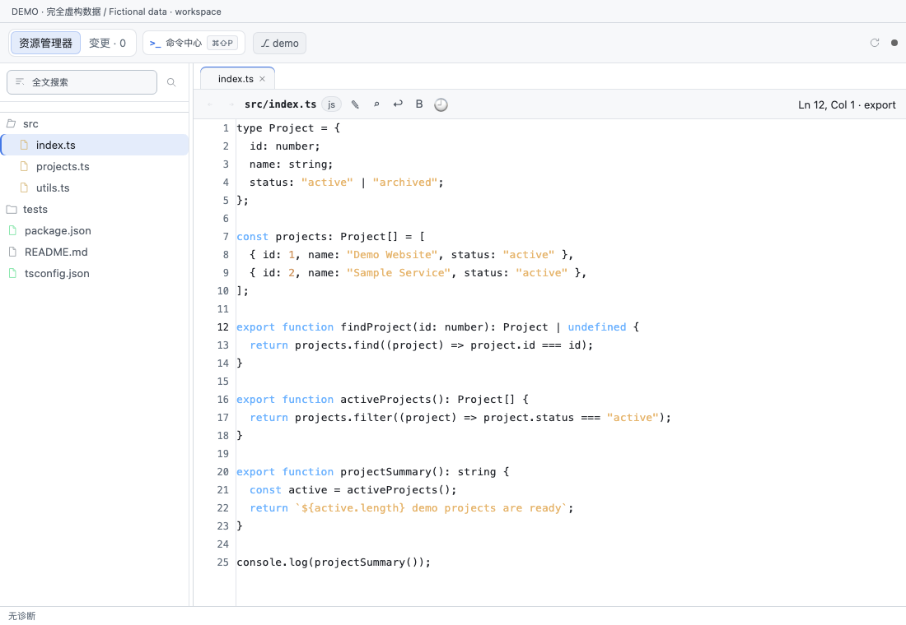
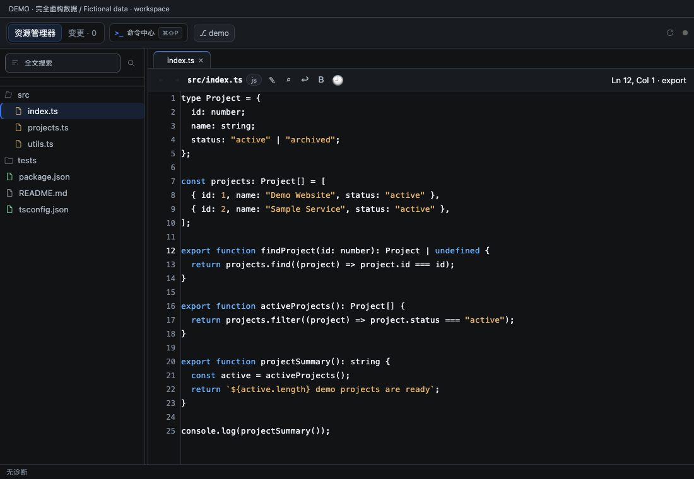
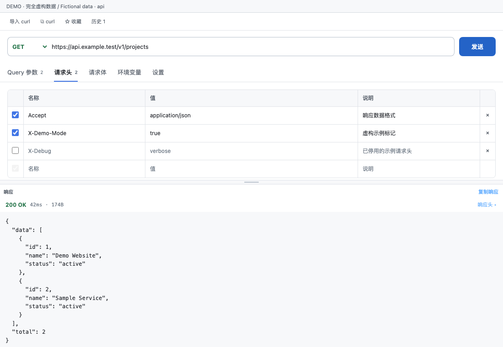
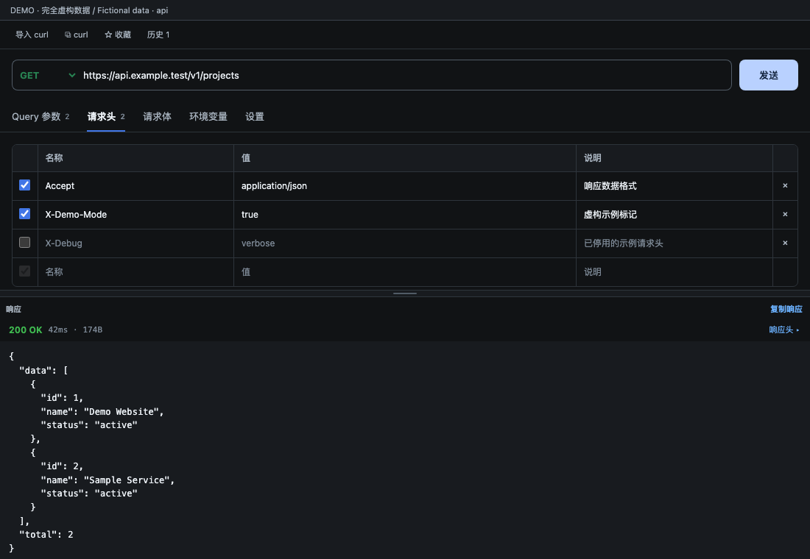
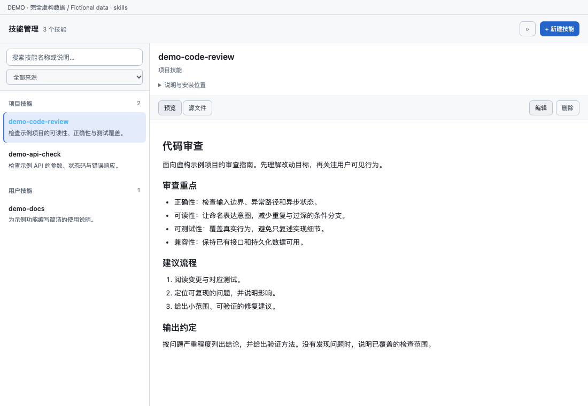
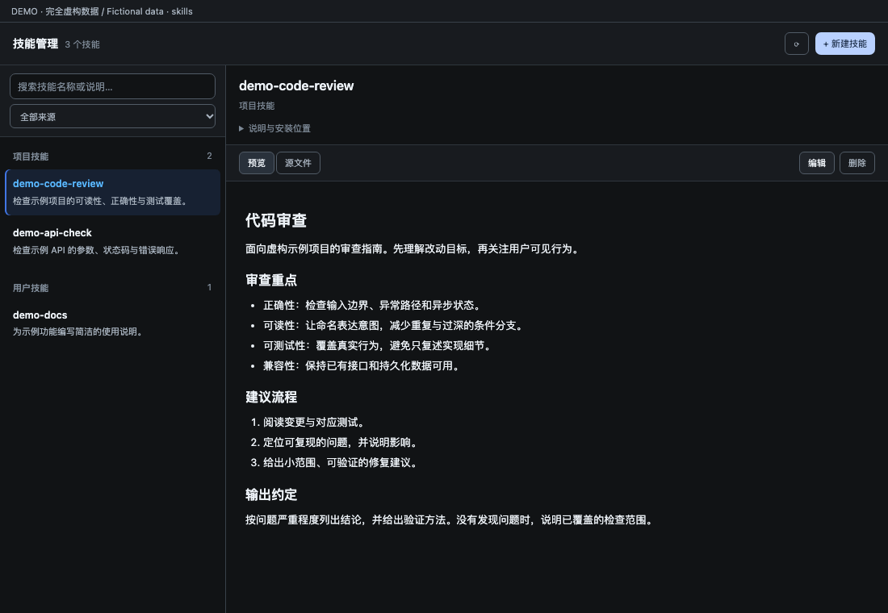

# dsh-plugin-kit

English | [简体中文](README.md)

**Browse code, review changes, test APIs, and manage skills while chatting with your Agent in DeepSeek Harness (DSH).**

`dsh-plugin-kit` places tool entry points in the DSH left navigation, alongside Plugins and Automations. Choose **Dev Workspace, API Tester, Skills Manager**, or an available browser/terminal entry to open it in the current session’s right workspace while keeping the conversation in the center. The right Start page is an empty-workspace guide rather than a duplicate launcher.

Dev Workspace combines file exploration, editing, search, symbols and Git review, with a keyboard-first Command Center (`⌘/Ctrl+Shift+P`). All surfaces support DSH light and dark themes.

## Screenshots and privacy

The README does not display real workspace or user-session screenshots, to avoid exposing usernames, local paths, project files, internal endpoints, cookies, tokens, or other personal information. UI examples use entirely fictional data and are reviewed before publication.

## UI previews — fictional data

These screenshots render the current plugin components with fictional fixtures and are marked **DEMO / Fictional data**. They are not screenshots of a real workspace or authenticated session. API examples use the reserved `example.test` domain; files, code and skills are sample content without real usernames, personal paths, internal endpoints or credentials. The previews show the Chinese UI.

| Feature | Light theme | Dark theme |
| --- | --- | --- |
| Dev Workspace |  |  |
| API Tester |  |  |
| Skills Manager |  |  |

[UI system / 主题与布局约定](docs/ui-system.md)

## What does this plugin do?

| Entry location | Tool | What you can do |
| --- | --- | --- |
| Left navigation | **Dev Workspace** | Unified file explorer, code editor, search, LSP navigation, and Git changes workbench. |
| Left navigation | **API Tester** | Import or copy curl, edit URLs, params, headers, bodies and environment variables, send HTTP requests, inspect responses, and save history and favorites. |
| Left navigation | New terminal | Open the built-in DSH terminal to run commands in the session workspace. |
| Left navigation | Browser | Open the built-in DSH browser. The launcher currently starts at Doubao; you can navigate to another URL afterward. |
| Left navigation | **Skills Manager** | Search, preview, edit, create and delete installed Agent skills; filter by project, user, built-in and plugin sources. |

**Scope:** the plugin provides Dev Workspace, API Tester, Skills Manager and left navigation integration. Host tool entries follow the live tab registry. Files are explored in Dev Workspace; browser and terminal capabilities depend on your profile. With no current session, navigation prompts you to select one and never queues the tool into a future unrelated session.

## Getting started

After installing, select a session and choose a tool from **left navigation** to open it in the right workspace. Click an already open tool entry again to close its tab; closing the last tool tab collapses the right sidebar. Unsaved code or skill text blocks closing and prompts you to save first.

- **Review Agent changes:** open Dev Workspace → Changes, then select a file for marked source or side-by-side diffs. You can also click an edit/write tool call in chat to inspect that specific change.
- **Find code:** use quick file open, find-in-file or workspace full-text search. Go, TS/JS and Python support definition/reference jumps when the matching language server is installed.
- **Test an API:** import curl or enter a request, edit the Params / Headers / Body / Settings tabs, then press `⌘/Ctrl+Enter` to send and inspect the response.
- **Maintain skills:** search and select a skill, switch between preview and source, and save editable skills with `⌘/Ctrl+S`. Built-in and plugin-provided skills remain read-only.

### Search scopes

- **Files → Full-text search** searches workspace code. Enter a relative directory or use the folder's **Find in this directory** context action to narrow it. Results are grouped by file and jump to the matching line.
- **Changes → File filter** filters the change list by filename/path.
- **Changes → Search changed content** searches on-disk content only in staged, working-tree and untracked files. Unmodified files and committed branch history are excluded; empty changes return no results and deleted files are skipped.
- Include/exclude globs further narrow the selected scope. `⌘/Ctrl+F` continues to search the open document.

## Features

- **Code**
  - Workspace file tree: lazy expansion, quick open (⌘P), full-text search (⇧⌘F, ripgrep, with **regex / whole-word toggles, multi-glob filters (`!` prefix excludes), results grouped by file with collapsible sticky headers, match highlighting, ▸ context expansion (±3 lines), and ▸ replace mode: per-file ⇄ / Replace All with two-step confirm + mtime conflict guard**), **create file/folder, rename, delete, 📋 copy path (⌥-click for relative), drag-to-move (folders and the root as drop targets)**, **auto-reveal (files opened from search/quick-open/LSP jumps expand and scroll into view)**, type-tinted file glyphs
  - VSCode-style editor: **multi-tab strip (per-tab cursor/scroll restore, middle-click close, dirty guard, persisted)**, virtual scrolling, **syntax highlighting for Go/TS/JS/Python/JSON/YAML/Shell/TOML/Rust/Java/C/SQL/CSS**, **LSP go-to-definition/references/implementation/hover (Go: gopls; TS/JS: typescript-language-server; Python: pyright/pylsp — whichever is installed)**, back/forward navigation, **✎ edit mode + ⌘S save (refuses to clobber files modified on disk since load)**, **⌘F find-in-file with Aa / ab| / .* toggles**, **↩ word wrap (⌥Z)**, **⌘G go-to-line (the Ln/Col chip is clickable)**
  - **Image preview**: png/jpg/gif/webp/avif/bmp/ico rendered from base64 data URLs (10 MiB cap) on a checkerboard backdrop with mime/size metadata
  - **B blame column**: author · relative time per commit run; click a blamed line to open that commit's diff; **🕘 file history**: every commit that touched the file (rename-following), click to see that commit's diff scoped to the file
  - Git changes: VSCode-style collapsible tree (directory counts, status letters, indent guides, duplicate-name disambiguation), **tree/list toggle**, per-file and per-directory **discard** (two-step confirm); **opening any file with uncommitted changes shows gutter diff marks automatically**
  - **Full git commit flow**: stage (+, per file or directory), unstage (−), **separate Staged (click = index vs HEAD) / Changes sections**, commit box (Enter commits; empty index ⇒ explicit "Stage All & Commit"; **amend toggle**), **push (publishes with -u when no upstream; never force)**, **stash section: save (optionally incl. untracked) / apply / pop / drop (two-step)**
  - **Branch committed changes**: whole-tree diff + file list against the **remote baseline branch** (the remote-tracking branch `origin/HEAD` points at, e.g. origin/master; local main/master only as a no-remote fallback); entries whose diff has no content hunks (mode/permission-only, binary, rename metadata, empty additions) show an explanatory note instead of "0 changed lines"
  - Change review: **whole-file view with changed-line marks** (green tint + gutter marks + folded deletion bars + a clickable change rail); the hunk view supports a **▥ side-by-side / ≡ unified toggle**, **word-level intra-line highlight**, **↑↓ change navigation**, and **⟲ per-hunk revert (git apply -R)**
  - Branch switcher: click the branch chip for a searchable palette (local/remote groups, fetch / ff-only pull / push)
  - Markdown / HTML / **SVG** files open in **rendered preview by default**, toggleable to raw
- **Skills**: search by name/description/path and filter project/user/built-in or plugin sources; compact list + detail columns on wide panels, list/detail navigation on narrow panels. Create inline on demand; Markdown preview/source view, editing with ⌘S save, and two-step deletion. Provided skills stay read-only, truncated content cannot be edited, unsaved changes block navigation, and stale reads cannot replace the selected skill; writes remain strictly fenced to the skill roots
- **API**: a basic Postman — one-click curl import (**-F parses into multipart fields**) and **⧉ copy-as-curl export**, **query params table (merged into the URL at send, same names override)**, **per-request timeout (1–120 s)**, **environment variables `{{var}}` (substituted in URL/headers/body at send time)**, method/URL/headers/body editors (form-urlencoded / **multipart** / raw with JSON beautify), Host-proxied send (no CORS issues), status/time/size + response headers + pretty JSON, **request history (last 30 sends recorded automatically, one-click restore)**, **named favorites**
- **Left navigation**: uses native `sidebar.panellist` and `layout` contracts to place tools alongside Plugins and Automations. Selecting a tool preserves Conversation and opens the current session’s right workspace. The right Start guide contains no duplicate tool entries.
- Chat edit/write tool calls render as compact rows; clicking one opens that call's diff in the side panel

## Install

Link-install inside a DSH profile (development mode):

```sh
dsh plugin add /abs/path/to/dsh-plugin-kit   # or install_bundle in the plugin manager
```

From git:

```sh
git clone https://gitee.com/wang-jun-07/dsh-plugin-kit.git
# install the directory via the plugin manager
```

LSP jumps require the matching language server on the Host's PATH (or in common global bin locations): `gopls` for Go, `typescript-language-server` for TS/JS, `pyright-langserver` or `pylsp` for Python. Missing servers degrade gracefully (the status dot reports it; everything else keeps working).

## Development

```sh
pnpm install
pnpm run build   # src/client/** -> client.js (DSH client module format)
pnpm test        # host routes + client pure logic + bundle shape, 6 suites (LSP cases auto-skip without gopls)
```

Regenerate the documentation screenshots with `node scripts/render-readme-previews.mjs` (requires Chrome; set `CHROME_BIN` to override its path). The script uses only embedded fictional fixtures and never connects to a real DSH service.

CI: `.github/workflows/ci.yml` (Node 20 + pnpm + gopls, runs on push/PR).

Host routes are served under `/code-explorer/api`: `fs.list fs.read fs.write fs.create fs.rename fs.delete git.status git.diff git.fetch git.pull git.push git.stage git.unstage git.commit git.discard git.revertHunk git.stash.list git.stash.save git.stash.apply git.stash.pop git.stash.drop git.branches git.checkout git.blame git.history lsp.request lsp.diagnostics lsp.status search.files search.text skills.list skills.read skills.write skills.create skills.delete api.send`. All file routes are fenced to the session workspace (reads additionally allow the parent sibling tree and Go toolchain roots for cross-repo jumps, but **hidden directories are never readable** through extra roots; writes are workspace-only — creates/renames realpath-recheck symlinked ancestors, and `fs.write` supports an optimistic-concurrency `baseMtime` guard that refuses to clobber external edits). Git index routes resolve paths against the **repository root** with a double fence (`:(literal)` pathspecs, so glob-metacharacter filenames are safe), supporting multi-repo workspaces and deleted files. **Git write routes** (fetch/pull/checkout/commit/push/stage/unstage/discard/revertHunk/stash mutations) refuse to operate on a repo that *encloses* the workspace — open the repository root as the workspace instead; read routes (status/diff/branches/blame/history) stay lenient.

## License

MIT © 2026 wang-jun-07
