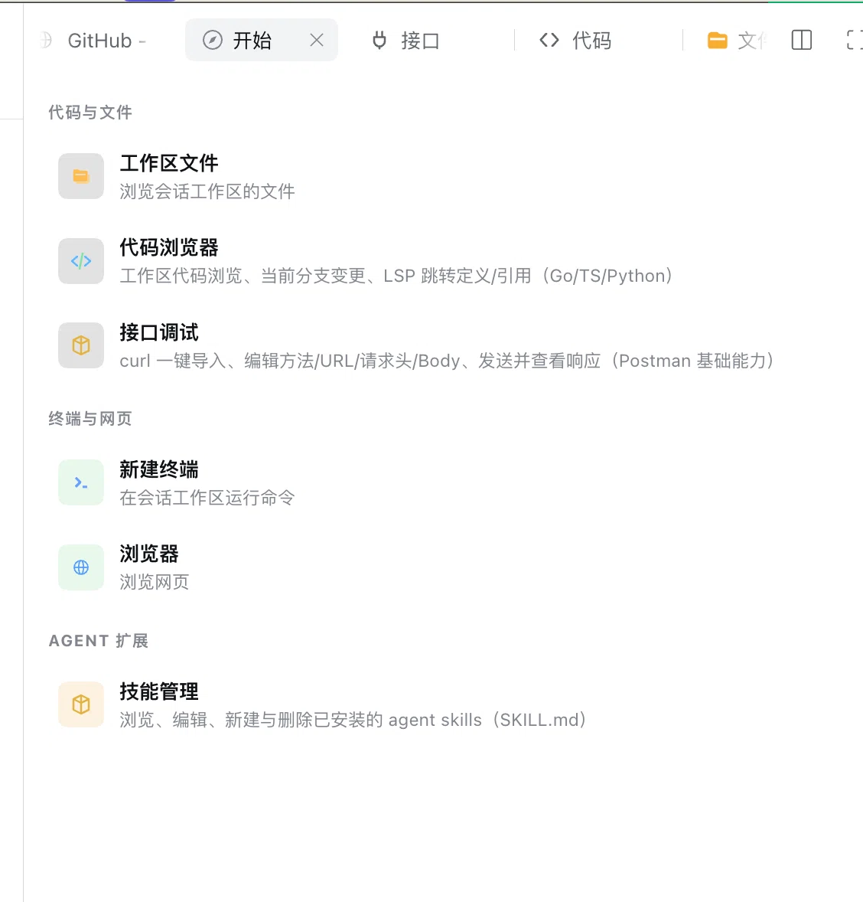
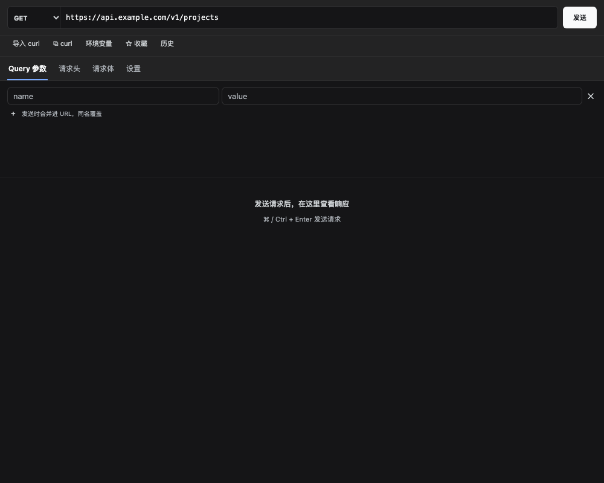
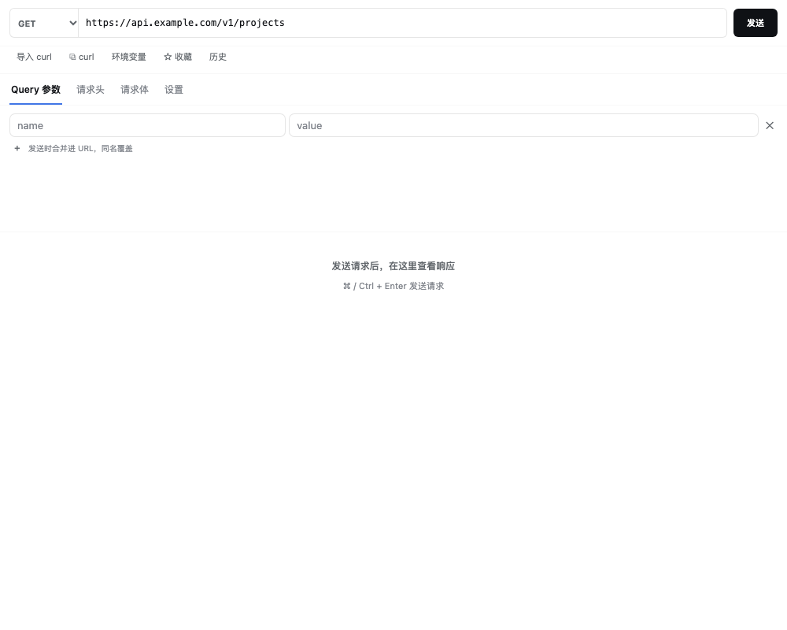
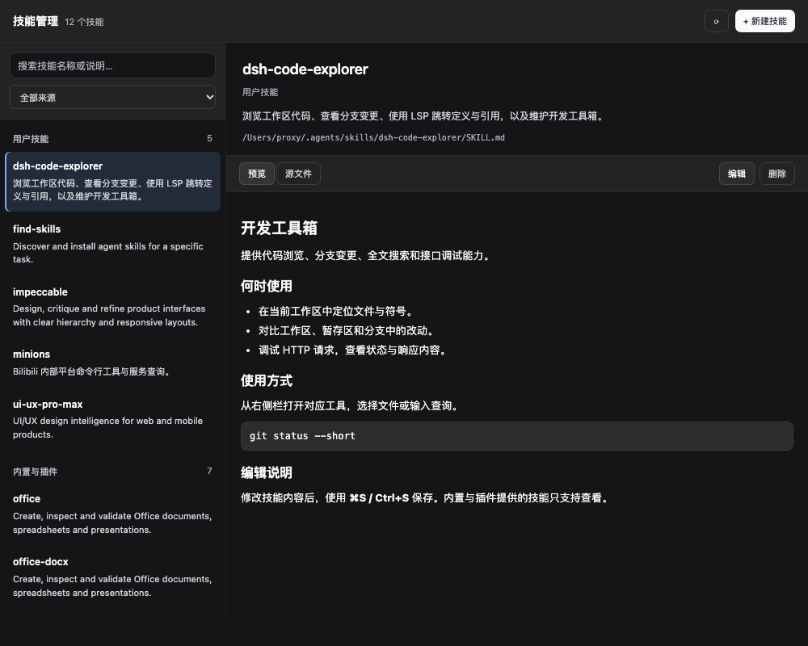
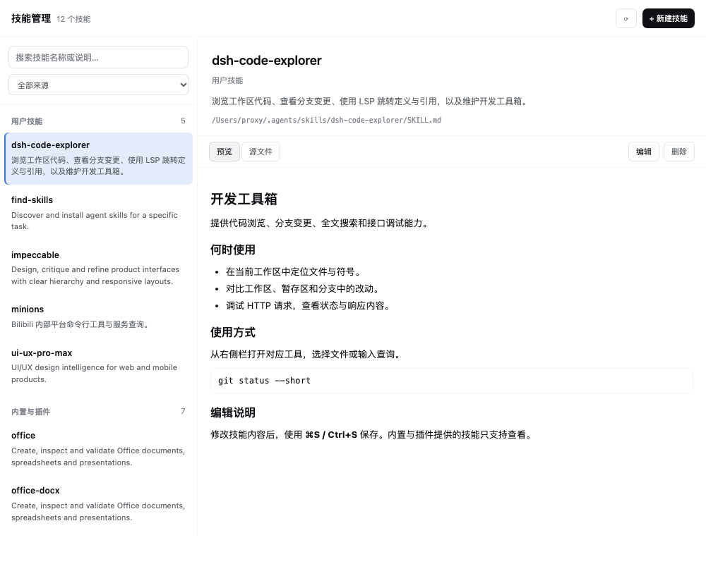

# dsh-plugin-kit

English | [简体中文](README.md)

**Browse code, review changes, test APIs, and manage skills while chatting with your Agent in DeepSeek Harness (DSH).**

`dsh-plugin-kit` adds three tools to the DSH right sidebar: **Code Explorer, API Tester, and Skills Manager**. It also organizes the Start page into task-based groups, keeping common development actions within the current session. Since v1.5.0, all surfaces share one visual system with three surface levels, clear type hierarchy, consistent spacing and control states, and support for DSH light and dark themes.



## UI previews

Component previews rendered with the DSH theme tokens and sample data; these are not production requests or live-session screenshots.

| API · Dark | API · Light |
| --- | --- |
|  |  |

| Skills · Dark | Skills · Light |
| --- | --- |
|  |  |

[UI system / 主题与布局约定](docs/ui-system.md)

## What does this plugin do?

| Start-page group | Tool | What you can do |
| --- | --- | --- |
| Code & Files | Workspace files | Open the built-in DSH file browser for the current session workspace. |
| Code & Files | **Code Explorer** | Browse and edit code, search files and code snippets, jump to definitions/references, review Git diffs, stage, commit, push, and manage stashes. |
| Code & Files | **API Tester** | Import or copy curl, edit URLs, params, headers, bodies and environment variables, send HTTP requests, inspect responses, and save history and favorites. |
| Terminal & Web | New terminal | Open the built-in DSH terminal to run commands in the session workspace. |
| Terminal & Web | Browser | Open the built-in DSH browser. The launcher currently starts at Doubao; you can navigate to another URL afterward. |
| Agent Extensions | **Skills Manager** | Search, preview, edit, create and delete installed Agent skills; filter by project, user, built-in and plugin sources. |

**Scope:** this plugin provides Code Explorer, API Tester, Skills Manager and the grouped launcher. Workspace files, Terminal and Browser use the built-in capabilities installed in your DSH profile; their entries depend on that profile. This is a DSH plugin, not a standalone IDE.

## Getting started

After installing, select a session in DSH, open **Start** in the right sidebar, and choose a tool:

- **Review Agent changes:** open Code Explorer → Changes, then select a file for marked source or side-by-side diffs. You can also click an edit/write tool call in chat to inspect that specific change.
- **Find code:** use quick file open, find-in-file or workspace full-text search. Go, TS/JS and Python support definition/reference jumps when the matching language server is installed.
- **Test an API:** import curl or enter a request, edit the Params / Headers / Body / Settings tabs, then press `⌘/Ctrl+Enter` to send and inspect the response.
- **Maintain skills:** search and select a skill, switch between preview and source, and save editable skills with `⌘/Ctrl+S`. Built-in and plugin-provided skills remain read-only.

## Features

- **Code**
  - Workspace file tree: lazy expansion, quick open (⌘P), full-text search (⇧⌘F, ripgrep, with **regex / whole-word toggles, multi-glob filters (`!` prefix excludes), results grouped by file with collapsible sticky headers, match highlighting, ▸ context expansion (±3 lines), and ▸ replace mode: per-file ⇄ / Replace All with two-step confirm + mtime conflict guard**), **create file/folder, rename, delete, 📋 copy path (⌥-click for relative), drag-to-move (folders and the root as drop targets)**, **auto-reveal (files opened from search/quick-open/LSP jumps expand and scroll into view)**, type-tinted file glyphs
  - VSCode-style editor: **multi-tab strip (per-tab cursor/scroll restore, middle-click close, dirty guard, persisted)**, virtual scrolling, **syntax highlighting for Go/TS/JS/Python/JSON/YAML/Shell/TOML/Rust/Java/C/SQL/CSS**, **LSP go-to-definition/references/implementation/hover (Go: gopls; TS/JS: typescript-language-server; Python: pyright/pylsp — whichever is installed)**, back/forward navigation, **✎ edit mode + ⌘S save (refuses to clobber files modified on disk since load)**, **⌘F find-in-file with Aa / ab| / .* toggles**, **↩ word wrap (⌥Z)**, **⌘G go-to-line (the Ln/Col chip is clickable)**
  - **Image preview**: png/jpg/gif/webp/avif/bmp/ico rendered from base64 data URLs (10 MiB cap) on a checkerboard backdrop with mime/size metadata
  - **B blame column**: author · relative time per commit run; click a blamed line to open that commit's diff; **🕘 file history**: every commit that touched the file (rename-following), click to see that commit's diff scoped to the file
  - Git changes: VSCode-style collapsible tree (directory counts, status letters, indent guides, duplicate-name disambiguation), **tree/list toggle**, per-file and per-directory **discard** (two-step confirm); **opening any file with uncommitted changes shows gutter diff marks automatically**
  - **Full git commit flow**: stage (+, per file or directory), unstage (−), **separate Staged (click = index vs HEAD) / Changes sections**, commit box (Enter commits; empty index ⇒ explicit "Stage All & Commit"; **amend toggle**), **push (publishes with -u when no upstream; never force)**, **stash section: save (optionally incl. untracked) / apply / pop / drop (two-step)**
  - **Branch committed changes**: whole-tree diff + file list against the **remote baseline branch** (the remote-tracking branch `origin/HEAD` points at, e.g. origin/master; local main/master only as a no-remote fallback); entries whose diff has no content hunks (mode/permission-only, binary, rename metadata, empty additions) show an explanatory note instead of "0 changed lines"
  - Change review: **whole-file view with changed-line marks** (green tint + gutter marks + folded deletion bars + a clickable change rail); the hunk view supports a **▥ side-by-side / ≡ unified toggle**, **word-level intra-line highlight**, **↑↓ change navigation**, and **⟲ per-hunk revert (git apply -R)**
  - Branch switcher: click the branch chip for a searchable palette (local/remote groups, fetch / ff-only pull / push)
  - Markdown / HTML / **SVG** files open in **rendered preview by default**, toggleable to raw
- **Skills**: search by name/description/path and filter project/user/built-in or plugin sources; compact list + detail columns on wide panels, list/detail navigation on narrow panels. Create inline on demand; Markdown preview/source view, editing with ⌘S save, and two-step deletion. Provided skills stay read-only, truncated content cannot be edited, unsaved changes block navigation, and stale reads cannot replace the selected skill; writes remain strictly fenced to the skill roots
- **API**: a basic Postman — one-click curl import (**-F parses into multipart fields**) and **⧉ copy-as-curl export**, **query params table (merged into the URL at send, same names override)**, **per-request timeout (1–120 s)**, **environment variables `{{var}}` (substituted in URL/headers/body at send time)**, method/URL/headers/body editors (form-urlencoded / **multipart** / raw with JSON beautify), Host-proxied send (no CORS issues), status/time/size + response headers + pretty JSON, **request history (last 30 sends recorded automatically, one-click restore)**, **named favorites**
- **Start-page launcher**: reworks the right-sidebar picker into a grouped compact list (Code & Files / Terminal & Web / Agent Extensions / More) via the official chain slot
- Chat edit/write tool calls render as compact rows; clicking one opens that call's diff in the side panel

## Install

Link-install inside a DSH profile (development mode):

```sh
dsh plugin add /abs/path/to/dsh-plugin-kit   # or install_bundle in the plugin manager
```

From git:

```sh
git clone https://gitee.com/wang-jun-07/dsh-plugin-kit.git
# install the directory via the plugin manager
```

LSP jumps require the matching language server on the Host's PATH (or in common global bin locations): `gopls` for Go, `typescript-language-server` for TS/JS, `pyright-langserver` or `pylsp` for Python. Missing servers degrade gracefully (the status dot reports it; everything else keeps working).

## Development

```sh
pnpm install
pnpm run build   # src/client/** -> client.js (DSH client module format)
pnpm test        # host routes + client pure logic + bundle shape, 6 suites (LSP cases auto-skip without gopls)
```

CI: `.github/workflows/ci.yml` (Node 20 + pnpm + gopls, runs on push/PR).

Host routes are served under `/code-explorer/api`: `fs.list fs.read fs.write fs.create fs.rename fs.delete git.status git.diff git.fetch git.pull git.push git.stage git.unstage git.commit git.discard git.revertHunk git.stash.list git.stash.save git.stash.apply git.stash.pop git.stash.drop git.branches git.checkout git.blame git.history lsp.request lsp.diagnostics lsp.status search.files search.text skills.list skills.read skills.write skills.create skills.delete api.send`. All file routes are fenced to the session workspace (reads additionally allow the parent sibling tree and Go toolchain roots for cross-repo jumps, but **hidden directories are never readable** through extra roots; writes are workspace-only — creates/renames realpath-recheck symlinked ancestors, and `fs.write` supports an optimistic-concurrency `baseMtime` guard that refuses to clobber external edits). Git index routes resolve paths against the **repository root** with a double fence (`:(literal)` pathspecs, so glob-metacharacter filenames are safe), supporting multi-repo workspaces and deleted files. **Git write routes** (fetch/pull/checkout/commit/push/stage/unstage/discard/revertHunk/stash mutations) refuse to operate on a repo that *encloses* the workspace — open the repository root as the workspace instead; read routes (status/diff/branches/blame/history) stay lenient.

## License

MIT © 2026 wang-jun-07
