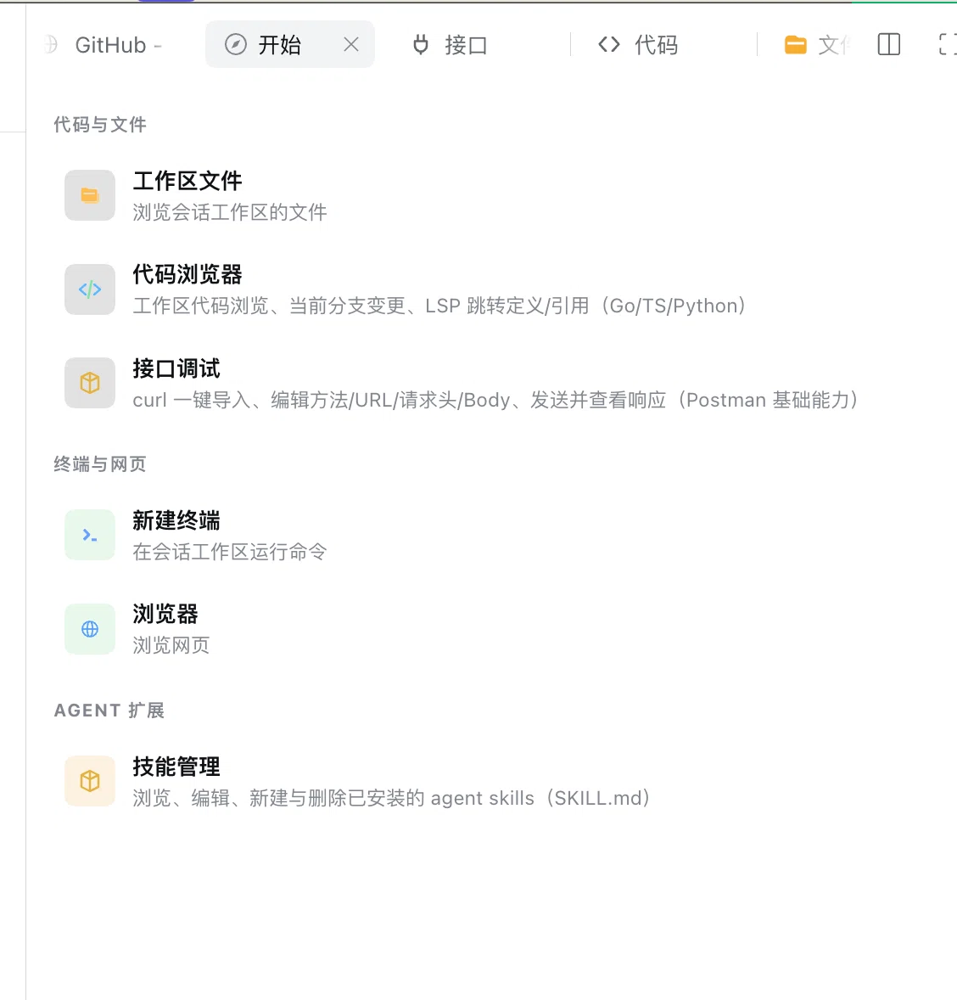

# dsh-plugin-kit

[English](README.en.md) | 简体中文

**在 DeepSeek Harness（DSH）里，边和 Agent 聊天，边查看代码、审查改动、调试接口和管理技能。**

`dsh-plugin-kit` 是 DSH 右侧边栏的开发工具箱插件。它新增 **代码浏览器、接口调试、技能管理**三个标签页，并把“开始”页整理成按任务分组的工具入口，让你在当前会话中完成常用开发操作。



## 这个插件能做什么？

| 开始页分组 | 工具入口 | 用途 |
| --- | --- | --- |
| 代码与文件 | 工作区文件 | 打开 DSH 内置文件浏览器，浏览当前会话的工作区。 |
| 代码与文件 | **代码浏览器** | 浏览与编辑代码，搜索文件和代码片段，跳转定义/引用；查看 Git diff，暂存、提交、推送与管理 stash。 |
| 代码与文件 | **接口调试** | 导入或复制 curl，配置 URL、参数、请求头、请求体和环境变量，发送 HTTP 请求并查看响应；保存历史与收藏。 |
| 终端与网页 | 新建终端 | 打开 DSH 内置终端，在会话工作区运行命令。 |
| 终端与网页 | 浏览器 | 打开 DSH 内置浏览器；当前启动器默认进入豆包官网，之后可自行输入其他地址。 |
| Agent 扩展 | **技能管理** | 搜索、预览、编辑、新建和删除已安装的 Agent skills；按项目、用户、内置与插件来源筛选。 |

**功能范围：**代码浏览器、接口调试、技能管理和分组启动器由本插件提供；工作区文件、终端和浏览器复用 DSH 已安装的内置能力，入口是否出现取决于当前 profile。它需要在 DSH 中安装使用，不是独立运行的 IDE。

## 从哪里开始？

安装后，在 DSH 中选择一个会话，打开右侧边栏的 **开始** 页，再选择需要的工具：

- **想检查 Agent 改了什么**：打开代码浏览器的“变更”页，选择文件查看整文件标注或并排 diff；也可以直接点击聊天中的 edit/write 工具调用行查看该次改动。
- **想定位代码**：使用文件快速打开、当前文件查找或工作区全文搜索；Go、TS/JS、Python 可在安装对应语言服务器后跳转定义和引用。
- **想测试接口**：打开接口调试，导入 curl 或填写请求，使用参数 / 请求头 / 请求体 / 设置标签编辑，按 `⌘/Ctrl+Enter` 发送并查看响应。
- **想维护 Agent 技能**：打开技能管理，搜索并选择技能，在预览和源文件间切换；可编辑技能支持 `⌘/Ctrl+S` 保存，内置与插件技能保持只读。

## 功能

- **代码（Code）**
  - 工作区文件树：懒加载展开、快速打开（⌘P）、全文搜索（⇧⌘F，ripgrep，**正则 / 全词开关、多 glob 过滤（`!` 前缀排除）、结果按文件分组折叠、匹配文本高亮、▸ 展开上下文 ±3 行、▸ 替换模式：单文件 ⇄ / 全部替换（两步确认 + mtime 冲突守卫）**）、**新建文件/文件夹、重命名、删除、📋 复制路径（⌥ 复制相对路径）、拖拽移动（目录/根均可放置）**、**自动 reveal（从搜索/快速打开/LSP 跳转打开的文件自动展开定位）**、按类型着色的文件图标
  - VSCode 风格编辑器：**多标签页（切换恢复光标/滚动位置、中键关闭、脏守卫、持久化）**、虚拟滚动、**Go/TS/JS/Python/JSON/YAML/Shell/TOML/Rust/Java/C/SQL/CSS 语法着色**、**LSP 跳转定义/引用/实现/悬停（Go：gopls；TS/JS：typescript-language-server；Python：pyright/pylsp，装了哪个用哪个）**、前进后退栈、**✎ 编辑 + ⌘S 保存（磁盘外部修改时拒绝盲写）**、**⌘F 文件内查找（Aa 大小写 / ab| 全词 / .* 正则）**、**↩ 自动换行（⌥Z）**、**⌘G 跳转到行（Ln/Col 徽标可点击）**
  - **图片预览**：png/jpg/gif/webp/avif/bmp/ico 以 base64 dataURL 渲染（10 MiB 上限），棋盘格衬底 + mime/大小信息
  - **B 行追溯（blame）**：作者 · 相对时间列，点击跳提交 diff；**🕘 文件历史**：该文件全部提交（含重命名跟随），点击看该提交中此文件的 diff
  - Git 变更：VSCode 风格可折叠树（目录计数、状态字母、缩进参考线、重名消歧）、**树状/平铺切换**、单文件/目录**回退变更**（两步确认）；**打开任何有未提交变更的文件自动显示装订线标记**
  - **Git 提交闭环**：暂存（+/目录级）、取消暂存（−）、**暂存区（点击看 index vs HEAD）/工作区分区展示**、提交框（Enter 提交；无暂存时显式「全部暂存并提交」；**amend 修补开关**）、**push（无上游自动 publish -u，绝不 force）**、**贮藏（stash）区：保存（可含未跟踪）/应用/弹出/删除（两步确认）**
  - **分支已提交变更**：相对**远程基线分支**（`origin/HEAD` 指向的远程跟踪分支，如 origin/master；无远程时回退本地 main/master）的整树 diff + 文件列表；无内容 hunk 的条目（仅模式/权限、二进制、重命名元数据、空新增）会显示原因说明而非"变更行 0"
  - 变更查看：**整文件 + 变更行标注**（绿底 + 左边条 + 删除行折叠红条 + 右侧变更导轨光斑点击跳转）；hunk 视图支持 **▥ 并排（side-by-side）/ ≡ 统一切换**、**词级行内高亮**、**↑↓ 变更导航**、**⟲ 单 hunk 回退（git apply -R）**
  - 分支切换器：点分支 chip 弹出可搜索面板（本地/远程分组、fetch/pull ff-only/push）
  - Markdown / HTML / **SVG** 文件**默认渲染预览**，可切原始态
- **技能（Skills）**：支持按名称/说明/路径搜索与项目/用户/内置插件来源筛选；宽栏为紧凑列表 + 详情双栏，窄栏为列表/详情切换。新建表单按需展开，详情支持 Markdown 预览/源文件查看、编辑与 ⌘S 保存、两步删除；内置与插件技能只读，截断内容禁止编辑，未保存修改阻止切换，慢请求不会覆盖当前技能；写入严格围栏在 skill 根目录内
- **接口（API）**：基础 Postman——curl 一键导入（**-F 解析为 multipart 字段**）与 **⧉ 一键导出 curl**、**Query 参数表（发送时合并进 URL，同名覆盖）**、**超时设置（1–120s）**、**环境变量 `{{var}}`（发送时替换 URL/头/体）**、方法/URL/Headers/Body（form-urlencoded / **multipart** / raw + JSON 格式化）编辑、Host 代理发送（无 CORS 问题）、状态/耗时/大小/响应头/JSON 美化展示、**请求历史（自动记录最近 30 条，一键回填）**、**命名收藏**
- **开始页启动器**：通过官方 chain 插槽把右侧边栏选择器重排为分组紧凑列表（代码与文件 / 终端与网页 / Agent 扩展 / 更多）
- 聊天内 edit/write 工具调用渲染为紧凑行，点击在侧栏打开该次调用的 diff

## 安装

DSH profile 内 link 安装（开发态）：

```sh
dsh plugin add /abs/path/to/dsh-plugin-kit   # 或插件管理器 install_bundle
```

从 git 安装：

```sh
git clone https://gitee.com/wang-jun-07/dsh-plugin-kit.git
# 插件管理器安装该目录
```

LSP 跳转按语言需要对应 server 在 Host 的 PATH（或常见全局 bin 目录）：Go 用 `gopls`，TS/JS 用 `typescript-language-server`，Python 用 `pyright-langserver` 或 `pylsp`。未安装时优雅降级（状态点提示，不影响其他功能）。

## 开发

```sh
pnpm install
pnpm run build   # src/client/** -> client.js（DSH 客户端模块格式）
pnpm test        # host 路由 + client 纯逻辑 + bundle 形状，6 个套件（gopls 缺失时 LSP 用例自动跳过）
```

CI：`.github/workflows/ci.yml`（Node 20 + pnpm + gopls，push/PR 触发）。

Host 路由前缀 `/code-explorer/api`：`fs.list fs.read fs.write fs.create fs.rename fs.delete git.status git.diff git.fetch git.pull git.push git.stage git.unstage git.commit git.discard git.revertHunk git.stash.list git.stash.save git.stash.apply git.stash.pop git.stash.drop git.branches git.checkout git.blame git.history lsp.request lsp.diagnostics lsp.status search.files search.text skills.list skills.read skills.write skills.create skills.delete api.send`。所有文件类路由围栏在会话工作区内（读额外放行父级兄弟目录与 Go 工具链根以供跨仓跳转，但**隐藏目录一律不可读**；写严格限工作区，创建/重命名对符号链接祖先做 realpath 复检，且支持 `baseMtime` 乐观并发守卫——磁盘外部修改后拒绝盲写）；git 索引类路由的路径按**仓库根**解析并双重围栏（`:(literal)` pathspec，通配符文件名安全），支持多仓工作区与已删除文件；**git 写路由**（fetch/pull/checkout/commit/push/stage/unstage/discard/revertHunk/stash 变更）拒绝操作「包围工作区的更大仓库」——此时请以仓库根为工作区打开，读路由（status/diff/branches/blame/history）不受此限。

## 许可

MIT © 2026 wang-jun-07
