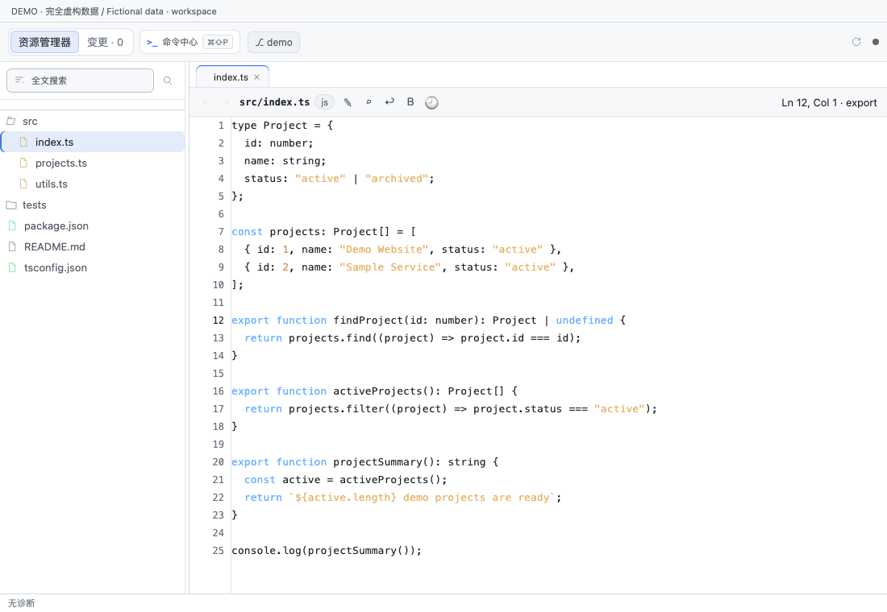
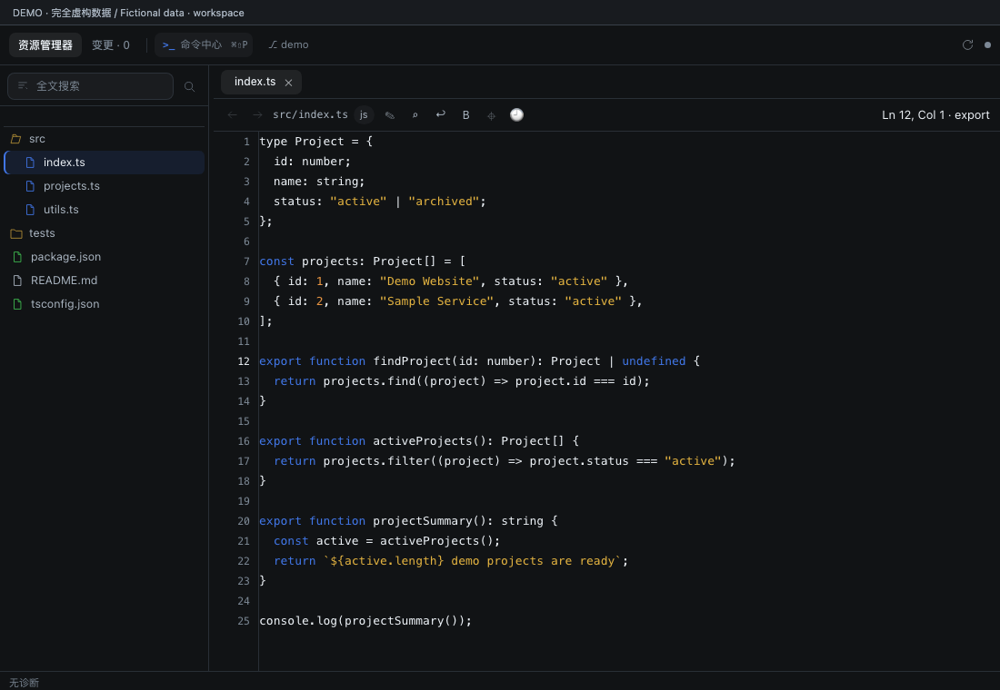
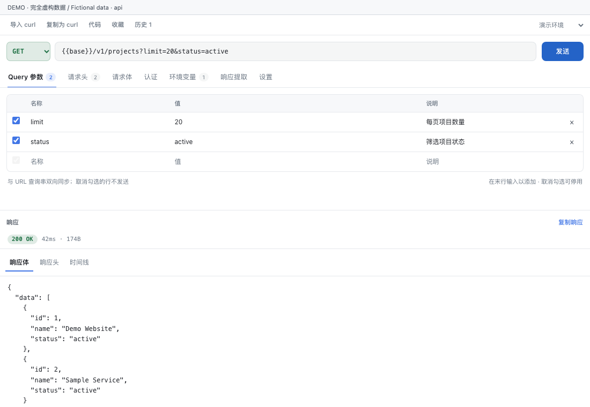
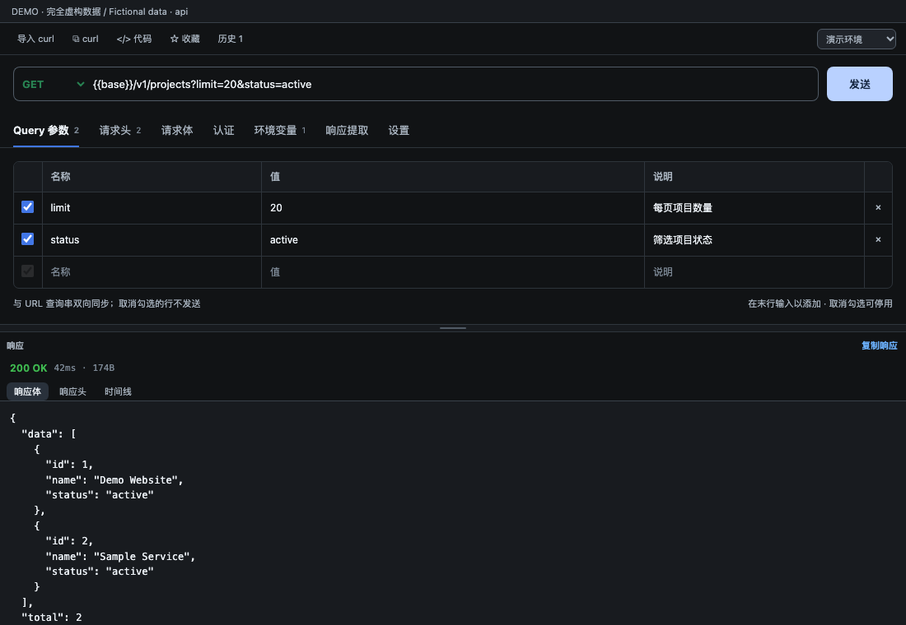
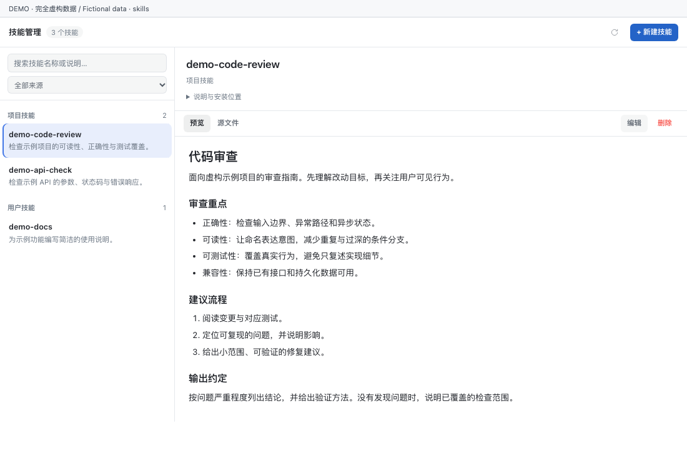
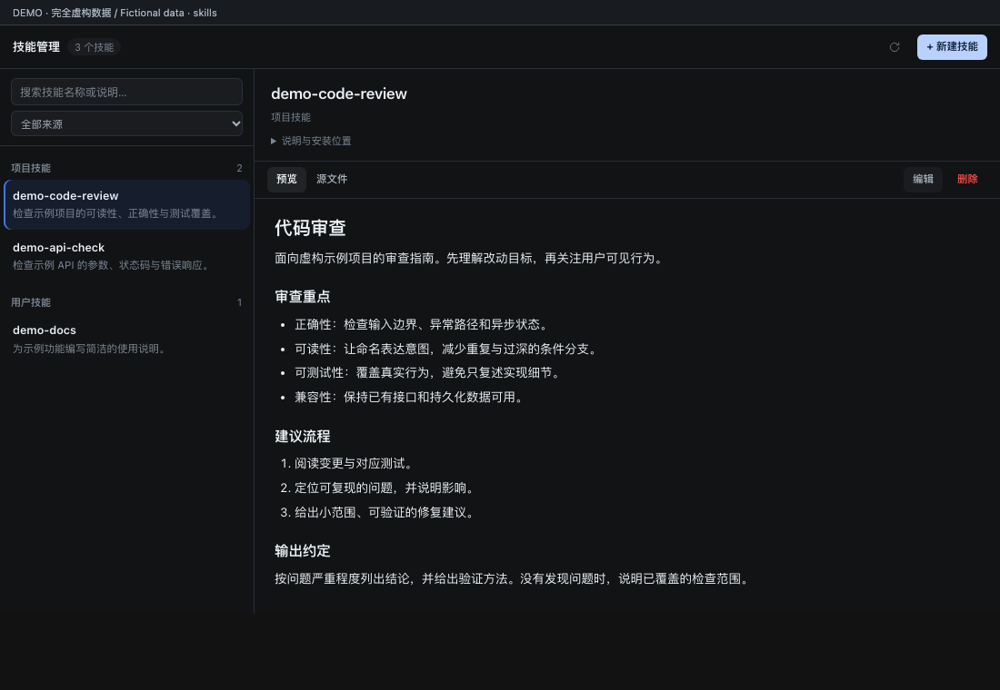
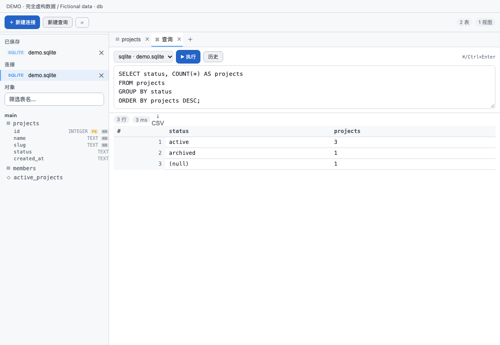
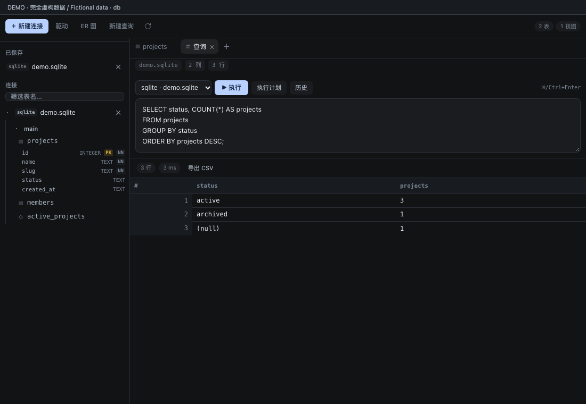
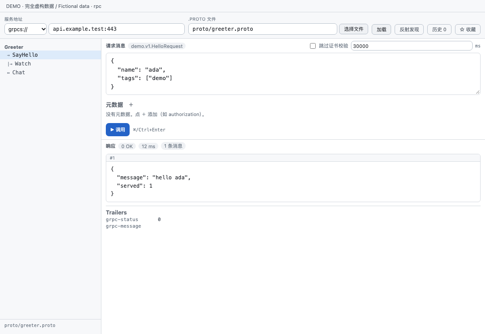
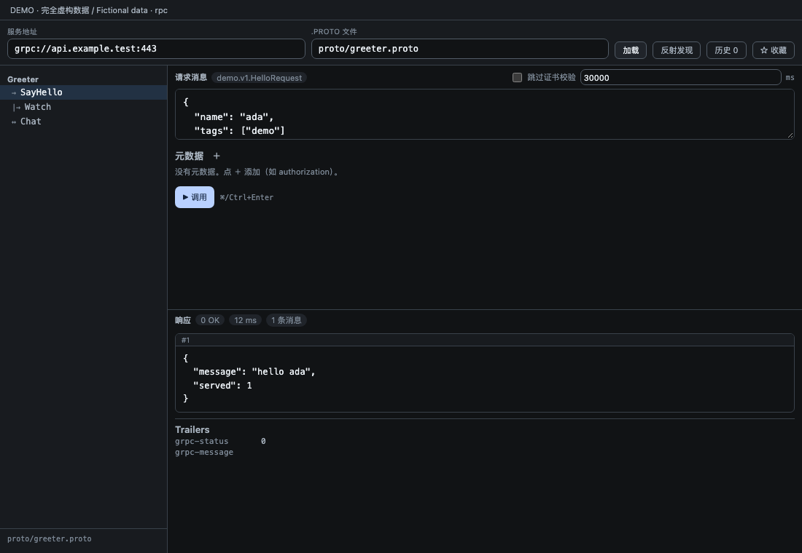

# dsh-plugin-kit

[English](README.en.md) | 简体中文

**在 DeepSeek Harness（DSH）里，边和 Agent 聊天，边查看代码、审查改动、调试接口和管理技能。**

`dsh-plugin-kit` 把开发工具入口统一放到 DSH 左侧导航，与“插件”“自动化任务”同级。点击 **开发工作台、接口调试（HTTP + gRPC）、技能管理**或可用的浏览器、终端入口后，当前会话的右侧工作区打开对应界面；中间保留对话区。右侧“开始”页只提示从左侧选择工具，不再重复展示启动列表。

开发工作台将文件浏览、编辑、搜索、符号导航、Git 审查和终端入口放在一个连续工作区，并提供命令中心（⌘/Ctrl+Shift+P）。界面适配 DSH 深色和浅色主题。

## 截图与隐私

README 不展示真实工作区或用户会话截图，避免暴露用户名、本地路径、项目文件、内部接口、Cookie、Token 等信息。界面示例仅使用完全虚构的数据，并在发布前检查图片内容。

## 界面预览（虚构示例）

以下截图由当前插件组件与虚构数据生成，均标有 **DEMO / Fictional data**，不是实际工作区或登录会话截图。接口使用保留的 `example.test` 域名，代码、文件列表和技能内容均为示例，不包含真实用户名、个人路径、内部接口或凭据。

| 功能 | 浅色主题 | 深色主题 |
| --- | --- | --- |
| 开发工作台 |  |  |
| 接口调试 |  |  |
| 技能管理 |  |  |
| 数据库 |  |  |
| RPC 调试 |  |  |

[UI system / 主题与布局约定](docs/ui-system.md)

## 这个插件能做什么？

| 入口位置 | 工具入口 | 用途 |
| --- | --- | --- |
| 左侧导航 | **开发工作台** | 统一的文件资源管理、代码编辑、搜索、LSP 导航和 Git 变更工作区。 |
| 左侧导航 | **接口调试** | 导入或复制 curl，配置 URL、参数、请求头、请求体、认证与多环境变量，发送 HTTP 请求并查看响应、时间线与可运行代码片段；保存历史与收藏。 |
| 开发工作台内 | **终端** | 工具栏按钮与命令中心条目：打开**插件自带**的终端（自有 VT 模拟器与渲染器，DSH 只提供 shell 与数据流），在会话目录启动 shell，全屏 TUI（vim/lazygit）可用；命令中心另有「在系统终端中打开」，由 Host 调起 iTerm/Terminal 等原生窗口。DSH 自带终端仍可从左侧终端行或 `` ⌃` `` 打开。 |
| 左侧导航 | **浏览器** | 使用 DSH 批准的内嵌 Chromium，同一窗口内多子标签浏览，收藏当前页、管理分组书签与收藏栏，配置主页和新标签起始页。 |
| 左侧导航 | **技能管理** | 搜索、预览、编辑、新建和删除已安装的 Agent skills；按项目、用户、内置与插件来源筛选。 |
| 左侧导航 | **数据库** | 连本地 SQLite（内置 `node:sqlite`，零依赖）或经 CLI 的 MySQL / PostgreSQL（自动找 keg-only 的 `mysql-client` / `postgresql@N` 与 Postgres.app，也可在对话框里直接指定客户端路径）；库表树逐列展开、按名筛选，点表浏览数据（服务端排序、全列搜索、分页），多标签查询、SQL 历史、结果导出 CSV、单元格详情；连接可保存复用，密码存进插件的凭据库（不进 UI、不下发）。 |
| 接口调试（HTTP / gRPC 同一页签） | **gRPC** | 顶部切到 gRPC：**地址只填 `host:port`**（`grpc://` / `grpcs://` 用旁边选择器），**点「选择文件」从工作区挑 `.proto`**（或直接填路径），或用 **反射发现** 直接向服务器索取 schema（不需要文件）；解析 service/method（含四种流式形态），按消息结构给出请求骨架，可加 metadata、设超时，展示状态码、消息、headers 与 trailers。调用会写入与 HTTP **共用的历史与收藏**，工作台顶部的合并历史里两类记录并列，点一下即回到对应协议。 |

数据库面板的「新建连接」只问**连接地址**：粘贴 `postgres://…`、`mysql://…` 或指向一个 `.sqlite` 文件，驱动自动识别（也可在高级里手动指定）。

**功能范围：**开发工作台、接口调试、技能管理和左侧入口整理由本插件提供；浏览器等工具复用已安装的宿主能力，按注册情况出现在左侧，终端入口收在开发工作台内（插件自渲染；系统终端作为第二入口，`⌃ + 反引号` 仍开 DSH 自带终端）。文件浏览统一进入开发工作台。没有当前会话时会提示先选择会话，不会自动创建会话或延后打开到其他会话。

### 浏览器收藏与设置

从左侧打开浏览器，窗口顶部是**子标签条**：**＋** 在同一窗口内新建标签，每个标签各自保留地址、历史与标题，新标签按设置里的起始页（主页或书签）打开；点击标签切换、× 关闭；桌面版中网页的 `window.open` / `target=_blank` 链接自动开为后台子标签；右侧标签栏标题固定为「浏览器」，页面标题只展示在子标签上。地址栏旁的 **☆** 收藏当前页；**▤** 打开书签管理，支持搜索、分组、仅收藏筛选、编辑和两步删除；**⚙** 设置主页、新标签起始页和收藏栏。书签和设置持久保存在当前 Host 的 DSH profile 中，并由工具页共享。系统浏览器打开按钮可用于无法内嵌的网站。

**扩展能力边界：**当前 DSH 桌面桥接没有开放 Chrome 扩展安装、启停或配置接口，因此不支持 CRX、本地扩展目录或系统浏览器扩展导入。此处“浏览器设置”不等同于 Chrome 扩展管理。登录状态与下载权限遵循 DSH 宿主策略，不能保证登录存储跨应用重启保留。Web 客户端退化为受限 iframe，部分网站不可嵌入，地址不可读时禁用收藏。

Agent 可调用 `browser_bookmarks` 管理同一书签库；UI 与工具共用持久化及校验逻辑。

## 从哪里开始？

安装后，在 DSH 中选择一个会话，再从 **左侧导航** 选择工具；对应界面会在右侧工作区打开。再次点击已打开的工具入口会关闭对应标签，关闭最后一个工具标签后收起右侧栏；未保存的代码或技能正文会阻止关闭并提示先保存。

- **开发工作台**：从资源管理器打开文件，或进入变更查看整文件标注与并排 diff；也可以直接点击聊天中的 edit/write 工具调用行查看该次改动。需要跑命令时，点工具栏的**终端**按钮（或命令中心里的同名命令）：工作台打开自己的终端标签页——VT 模拟器、行渲染与输入编码都是插件实现，DSH 只负责拉起 shell、维护无头屏幕并在重连时给出快照。每帧输出只重绘一次、只重绘变化的行，所以在 powerlevel10k 这类高频重绘的提示符下也不会出现半截 prompt 或退格残影；vim、lazygit、htop 这类全屏 TUI 可用，中文与 emoji 按双格宽度对齐。命令中心另有「在系统终端中打开」：由 Host 在当前会话目录调起 iTerm/Terminal（Linux/Windows 取对应终端）并 detach，适合远程 shell 或 GPU TUI。两处的命令都以你的系统用户权限运行，**不受 Agent 的沙箱与审批策略约束**。开着**实时刷新**时，Agent 或终端改动的文件会自动同步进编辑器、文件树与 Git 徽标；有未保存草稿则只弹横幅让你选「重新加载 / 保持编辑」，绝不覆盖你的手改。
- **想定位代码**：使用代码 IDE 的命令中心（⌘/Ctrl+Shift+P）、文件快速打开、当前文件查找或工作区全文搜索；Go、TS/JS、Python 可在安装对应语言服务器后跳转定义（F12 / ⌘点击）和**查找引用**（工具栏 ⌖、命令中心「查找引用」或 ⇧F12），结果在右侧浮层里按文件分组、点行直达；服务会自动从**项目自身的 `node_modules/.bin` / `.venv/bin`**、PATH 以及常见的按用户安装位置找，找不到时提示安装命令，⌥⌘O 还支持**工作区符号搜索**（输入函数/类型名直达定义）；对受 LSP 支持的语言，**保存时格式化**默认开启（gofmt / prettier 级效果，格式化失败绝不丢保存）。
- **想测试接口**：打开接口调试，导入 curl 或填写请求，使用参数 / 请求头 / 请求体 / 认证 / 变量 / 设置标签编辑（URL 与参数表双向同步，环境变量支持多套命名切换），按 `⌘/Ctrl+Enter` 发送并查看响应体、响应头与时间线；**</> 代码** 可复制按当前环境解析后的 curl / JS fetch / Python requests 片段。
- **想维护 Agent 技能**：打开技能管理，搜索并选择技能，在预览和源文件间切换；可编辑技能支持 `⌘/Ctrl+S` 保存，内置与插件技能保持只读。

### 搜索范围

- **文件页 → 全文搜索**：搜索当前工作区的代码内容；可在“搜索目录”输入相对目录，或右键目录选择“在此目录中搜索”。结果按文件分组，点击片段跳转到行。
- **变更页 → 文件筛选**：只按名称/路径过滤变更列表。
- **变更页 → 搜索变更内容**：只查当前暂存区、工作区和未跟踪文件的磁盘内容；不包含未改动文件或已提交分支历史。空变更返回空结果，删除文件跳过。
- `*.go`、`!*.test.js` 等文件过滤只进一步缩小当前范围；`⌘/Ctrl+F` 始终查找当前打开文件。

## 功能

- **开发工作台（Workspace）**
  - 变更路径复制：树状/平铺视图的文件和目录行提供复制按钮。点击复制绝对路径，Alt/⌥ 点击复制仓库相对路径；暂存、工作区、分支变更与已删除文件均可用，多仓工作区按对应仓库根解析；**复制成功后按钮原地变 ✓ 约 1.4 秒，失败只报错不假成功**。
  - 文件拖拽：资源管理器文件拖到编辑区打开源文件；变更文件（树状/平铺、含已删除文件）拖入打开对应 diff；编辑器标签可拖动排序。资源管理器内拖到目录仍为移动磁盘文件。编辑区不接收跨会话/其他工作区目录或系统文件；有未保存修改时阻止切换。
  - 资源管理器：懒加载展开、快速打开（⌘P）、全文搜索（⇧⌘F，ripgrep，**正则 / 全词开关、多 glob 过滤（`!` 前缀排除）、结果按文件分组折叠、匹配文本高亮、▸ 展开上下文 ±3 行、▸ 替换模式：单文件 ⇄ / 全部替换（两步确认 + mtime 冲突守卫）**）、**新建文件/文件夹、重命名、删除、📋 复制路径（⌥ 复制相对路径，成功原地 ✓ 反馈）、拖拽移动（目录/根均可放置）**、**自动 reveal（从搜索/快速打开/LSP 跳转打开的文件自动展开定位）**、按类型着色的文件图标
  - **编辑器生产力**：**⌥⌘O 工作区符号搜索**（经 gopls / typescript-language-server / pyright 的 workspace/symbol，输入名称直达定义，220ms 去抖 + 序号守卫，无打开文档时按工作区标记探测语言）、**保存时格式化**（默认开启、可切换并持久化）：Go/TS/JS/Python 草稿先经 `baseMtime` 冲突守卫落盘、再由语言服务器格式化并回填编辑器，保存提示区分「已保存并格式化」；格式化失败**绝不丢保存**
  - VSCode 风格编辑器：**多标签页（切换恢复光标/滚动位置、中键关闭、脏守卫、持久化）**、**标签右键菜单（固定 / 关闭 / 关闭其他 / 关闭右侧 / 全部关闭；固定标签置顶且批量关闭时跳过，同 VS Code sticky）**、**⌘⇧T 重开已关闭编辑器（按最近关闭顺序恢复光标位置）**、虚拟滚动、**Go/TS/JS/Python/JSON/YAML/Shell/TOML/Rust/Java/C/SQL/CSS 语法着色**、**LSP 跳转定义/引用/实现/悬停（Go：gopls；TS/JS：typescript-language-server；Python：pyright/pylsp，装了哪个用哪个）**、前进后退栈、**✎ 编辑 + ⌘S 保存（磁盘外部修改时拒绝盲写）**、**⌘F 文件内查找（Aa 大小写 / ab| 全词 / .* 正则，当前匹配实底高亮 + 装订线区分色）**、**⌘⌥F 查找替换（替换 / 全部替换，正则支持 $1/$& 组引用，AB 保留大小写；结果进入编辑态待审查，仍走 ⌘S 冲突守卫保存，绝不直接写盘）**、**↩ 自动换行（⌥Z）**、**⌘G 跳转到行（Ln/Col 徽标可点击）**、**问题面板（⇧⌘M 或点击诊断徽标：按严重级别列出当前文件 LSP 诊断，顶部错误/警告/信息计数可筛选，点击跳转行）**
  - **图片预览**：png/jpg/gif/webp/avif/bmp/ico 以 base64 dataURL 渲染（10 MiB 上限），棋盘格衬底 + mime/大小信息
  - **B 行追溯（blame）**：作者 · 相对时间列，点击跳提交 diff；**🕘 文件历史**：该文件全部提交（含重命名跟随），点击看该提交中此文件的 diff
  - Git 变更：**未跟踪文件支持逐行删除（🗑，两步确认，走围栏内 fs.delete 并从磁盘移除；目录级回退会跳过未跟踪并提示数量）**；VSCode 风格可折叠树（目录计数、状态字母、缩进参考线、重名消歧）、**树状/平铺切换**、单文件/目录**回退变更**（两步确认）；**打开任何有未提交变更的文件自动显示装订线标记**
  - **Git 提交闭环**：暂存（+/目录级）、取消暂存（−）、**暂存区（点击看 index vs HEAD）/工作区分区展示**、提交框（Enter 提交；无暂存时显式「全部暂存并提交」；**amend 修补开关**）、**push（无上游自动 publish -u，绝不 force）**、**贮藏（stash）区：保存（可含未跟踪）/应用/弹出/删除（两步确认）**
  - **分支已提交变更**：相对**远程基线分支**（`origin/HEAD` 指向的远程跟踪分支，如 origin/master；无远程时回退本地 main/master）的整树 diff + 文件列表；无内容 hunk 的条目（仅模式/权限、二进制、重命名元数据、空新增）会显示原因说明而非"变更行 0"
  - 变更查看：**整文件 + 变更行标注**（绿底 + 左边条 + 删除行折叠红条 + 右侧变更导轨光斑点击跳转）；hunk 视图支持 **▥ 并排（side-by-side）/ ≡ 统一切换**、**词级行内高亮**、**↑↓ 变更导航**、**⟲ 单 hunk 回退（git apply -R）**
  - 分支切换器：点分支 chip 弹出可搜索面板（本地/远程分组、fetch/pull ff-only/push）
  - **实时刷新**：宿主对工作区做递归文件监听，按路径合并、去抖后长轮询推送；未保存改动的文件**绝不被覆盖**——编辑器、文件树、Git 徽标与打开的 diff 自动跟随 Agent / 终端 / git 的磁盘变化；有脏草稿时弹出「重新加载 / 保持编辑」横幅由人选择。命令中心可「切换实时刷新」（默认开启），平台不支持监听时自动退回手动 ⟳ 并提示
  - **任务面板**：命令中心「▶ 运行任务…」列出工作区 package.json 的 scripts（只执行清单内脚本，名称先验 + 无 shell，杜绝注入）；输出面板经宿主 spawn + 长轮询流式追加，stdout/stderr 分轨、退出码/停止（SIGTERM→宽限 SIGKILL）/超限截断标记，go test / tsc / eslint / pytest / rustc 的失败行自动变成**可点击跳转**
  - **Git 对比与挑选**：命令中心「≷ 对比两个引用…」——base/head 双输入 + 分支点填，两引用树差异列成 name-status 组，点行看逐文件 compare diff，实时监听同样刷新它；提交列表每行 **⤵ cherry-pick**（两步确认、干净工作区前提、冲突以序列器状态为准回报）；**冲突解决横幅**：cherry-pick / merge / rebase / revert 进行中时按文件列出 ours/theirs 一键取侧（自动暂存）+ Continue / Abort
  - **终端**：工具栏「终端」按钮与命令中心条目打开插件自己的终端标签页。模拟器（`src/client/vt/screen.js`）负责主/备用缓冲区、回滚、光标、擦除/插入/删除、滚动区域、SGR（16/256/真彩色）、DEC 制表符图形、括号粘贴、OSC 标题与 DECSTBM；渲染器（`vt/render.js`）按行版本号只重绘变化的行、每个属性段一个 span，并把一帧内的多个输出块合并成一次绘制；输入（`vt/keys.js`）把按键编码成 VT 字节，字符走隐藏 textarea 的 `input` 事件以支持输入法与死键；鼠标（`vt/mouse.js`）在程序开启 1000/1002/1003 时按 SGR(?1006) 或 X10 上报点击、拖拽与滚轮，按住 Shift 仍可拖选；选择（`vt/selection.js`）以缓冲区坐标记录，拖选/双击选词/三击整行，`⌘C`/`Ctrl+Shift+C` 复制、`⌘A` 全选、`Shift+PageUp/PageDown/Home/End` 翻阅回滚，任何输入回到最新输出。进程与数据流仍属 DSH：`ctx.webTerminals` 提供 `snapshot`/`output` 帧，关页签释放进程，`retainTabs` 在页签存在期间持有它。另有一键「在系统终端中打开」，由 Host 探测并调起原生终端窗口。终端里的命令以你的系统用户权限运行，不受 Agent 沙箱与审批策略约束
  - Markdown / HTML / **SVG** 文件**默认渲染预览**，可切原始态
- **技能（Skills）**：支持按名称/说明/路径搜索与项目/用户/内置插件来源筛选；宽栏为紧凑列表 + 详情双栏，窄栏为列表/详情切换。新建表单按需展开，详情支持 Markdown 预览/源文件查看、编辑与 ⌘S 保存、两步删除；内置与插件技能只读，截断内容禁止编辑，未保存修改阻止切换，慢请求不会覆盖当前技能；写入严格围栏在 skill 根目录内
- **接口（API）**：参考 [Bruno](https://github.com/usebruno/bruno) 的请求工作区——curl 一键导入（**解析对齐 curlconverter：`$'ANSI-C'` 引号、`-XPOST`/`-H'K: V'` 粘连短参、`--flag=value`、`--form-string`、`--url-query`、空请求头 `Name;`；`-F` 解析为 multipart 字段；`-u` 与 `Authorization: Bearer/Basic` 头折叠进认证区；连续 `k=v` 数据识别为 form 表单**）、**Bruno `.bru` 集合文件导入/导出（纯文本、Git 友好；导出保留 `{{var}}` 模板与停用行，导入自动识别）**、**</> 代码生成（curl / JavaScript fetch / Python requests / .bru）**、**URL ↔ Query 参数表双向同步（改 URL 更新参数表、改参数表重建 URL；停用行退出 URL 但保留值；`:name` 路径参数独立成表、发送时替换）**、**多套命名环境变量 `{{var}}` + 工具栏切换器 + 「无环境」态**（旧版扁平变量表自动迁移为 Default 环境；发送时替换 URL/头/体）、**认证页签（None / Bearer / Basic，发送时生成 Authorization 并覆盖手写同名头）**、**超时设置（1–120s）**、方法/URL/Headers/Body（form-urlencoded / **multipart** / raw + JSON 格式化）编辑、Host 代理发送（无 CORS 问题）、响应区 **响应体 / 响应头 / 时间线** 三页签（时间线展示变量替换后实际发出的请求与响应元信息）、状态/耗时/大小展示、**请求历史（自动记录最近 30 条，一键回填）**、**命名收藏**、**响应提取**（六来源：JSON 路径 / 响应头 / 状态码 / 正文 / 正则捕获 / 请求查询参数，发送后自动写入当前激活环境供 `{{var}}` 链式使用；未命中只报告、绝不半写）、**SSE / EventStream 实时查看**（发送后自动转入「事件流」页签：逐事件行渲染 kind/id/retry/首行数据、自动滚动、停止按钮、尾部保留与截断标记，长轮询游标协议与任务面板同款、**集合落盘**（设置页指定工作区内的 `.bru` 目录：⇪ 读取把整个目录递归导入收藏；收藏可勾选同步写出 `<name>.bru`，先序列化后写盘、失败不分叉，Git/Agent 与面板共用同一份集合）**OpenAPI 3 与 Postman 集合导入**（粘贴 JSON 自动识别：每个 operation/请求转为一条收藏并回填第一条到编辑器；`{param}`→`:name` 路径参数、schema 采样请求体、Postman 文件夹展平）
- **左侧统一入口**：通过官方 `sidebar.panellist` 与 `layout` 接口，和插件/自动化任务同级展示；点击后保留对话区，在当前会话右侧打开工具。右侧开始页不再重复展示工具入口。
- **右侧栏宽度**：首次打开右侧栏时直接铺到宿主允许的最大宽度（不是默认的 45%），之后仍可自由拖拽；拖拽结果会被记住，下次打开恢复你拖到的宽度而不是再次弹到最大。
- 聊天内 edit/write 工具调用渲染为紧凑行，点击在侧栏打开该次调用的 diff

## 安装

DSH profile 内 link 安装（开发态）：

```sh
dsh plugin add /abs/path/to/dsh-plugin-kit   # 或插件管理器 install_bundle
```

从 git 安装：

```sh
git clone https://gitee.com/wang-jun-07/dsh-plugin-kit.git
# 插件管理器安装该目录
```

LSP 跳转按语言需要对应 server 在 Host 的 PATH（或常见全局 bin 目录）：Go 用 `gopls`，TS/JS 用 `typescript-language-server`，Python 用 `pyright-langserver` 或 `pylsp`。未安装时优雅降级（状态点提示，不影响其他功能）。

## 开发

```sh
pnpm install
pnpm run build   # src/client/** -> client.js（DSH 客户端模块格式）
pnpm test        # 构建 + host 路由 + client 纯逻辑 + 浏览器回归 + 搜索/嵌套/父子/远端，7 个套件（gopls 缺失时 LSP 用例自动跳过）
```

打包发布时会自动跑 `node scripts/build-client.mjs --min`（`prepack`），发布出去的 `client.js` 是压缩版（约 524 KB，未压缩约 808 KB）；仓库里保留可读版本。

重新生成文档截图：`node scripts/render-readme-previews.mjs`（需要 Node ≥ 22 与 Chrome，可用 `CHROME_BIN` 指定路径；单个无头 Chrome 实例通过 CDP 依次截取全部场景，仅使用脚本内的虚构数据，不连接真实 DSH 服务）。

数据库与 gRPC 相关的 host 用例需要运行时自带 `node:sqlite` 与 HTTP/2 的完整实现（Node ≥ 22.5）；用 DSH 自带的运行时跑可覆盖它们，否则这部分会自动跳过：

```sh
ELECTRON_RUN_AS_NODE=1 "$DSH_NODE_EXECUTABLE" test-host.mjs
```

CI：`.github/workflows/ci.yml`（push/PR 触发）。Node 20 跑完整套件；另有一个 **Node 24** job 专门跑 host + client，用于覆盖 `node:sqlite` 与 SQLite worker 的用例——Node 20 上这些会自动跳过。

Host 路由前缀 `/code-explorer/api`：`fs.list fs.read fs.write fs.create fs.rename fs.delete git.status git.diff git.fetch git.pull git.push git.stage git.unstage git.commit git.discard git.revertHunk git.stash.list git.stash.save git.stash.apply git.stash.pop git.stash.drop git.branches git.checkout git.blame git.history lsp.request lsp.diagnostics lsp.status search.files search.text skills.list skills.read skills.write skills.create skills.delete api.send`。所有文件类路由围栏在会话工作区内（读额外放行父级兄弟目录与 Go 工具链根以供跨仓跳转，但**隐藏目录一律不可读**；写严格限工作区，创建/重命名对符号链接祖先做 realpath 复检，且支持 `baseMtime` 乐观并发守卫——磁盘外部修改后拒绝盲写）；git 索引类路由的路径按**仓库根**解析并双重围栏（`:(literal)` pathspec，通配符文件名安全），支持多仓工作区与已删除文件；**git 写路由**（fetch/pull/checkout/commit/push/stage/unstage/discard/revertHunk/stash 变更）拒绝操作「包围工作区的更大仓库」——此时请以仓库根为工作区打开，读路由（status/diff/branches/blame/history）不受此限。

## 许可

MIT © 2026 wang-jun-07
