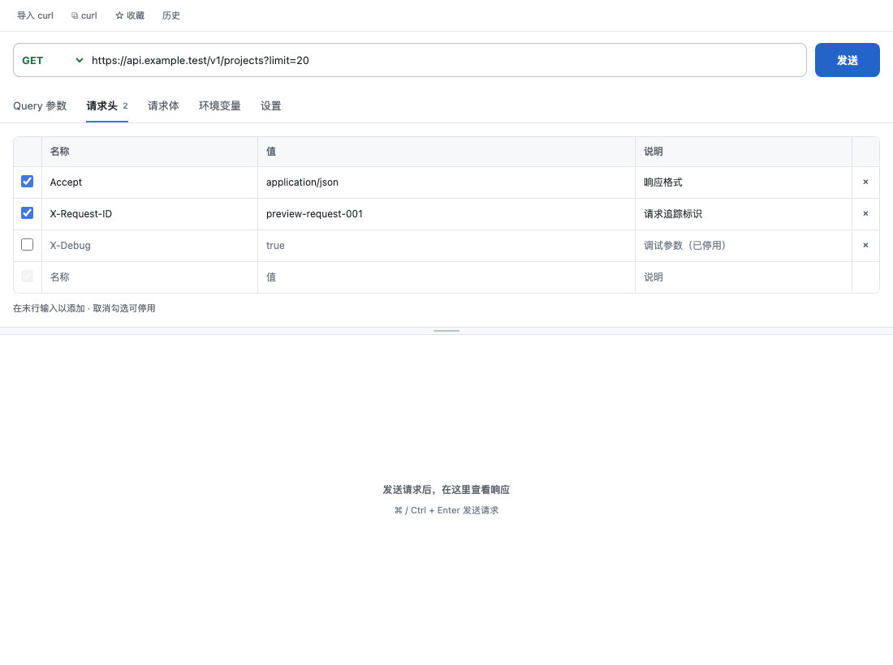
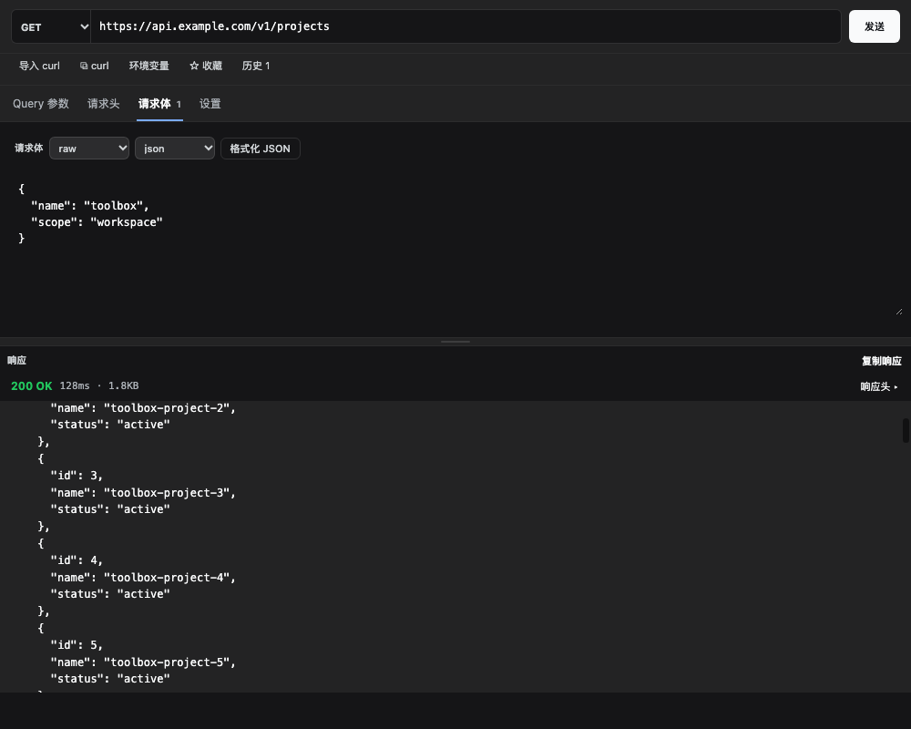
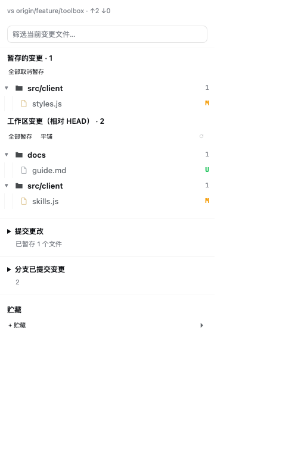
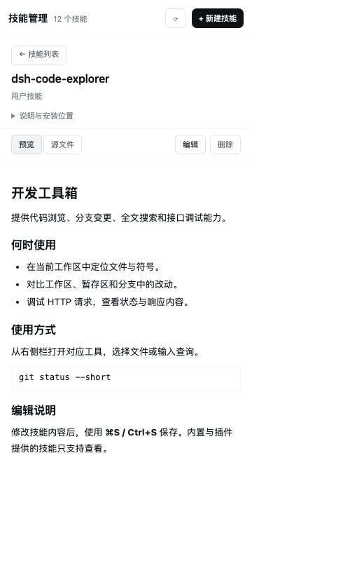

# Toolbox UI system

The toolbox is an **Operate** surface inside the DSH right sidebar: browsing source, reviewing changes, testing HTTP requests and maintaining skills. Its visual language stays compatible with the host application's light and dark themes.

## Entry points and work areas

Tool entry points live in native left `sidebar.panellist` rows alongside Plugins and Automations. The plugin registers matching `main` keys because the host validates those ids; its synchronous `layout.panelInfo` subscriber restores Conversation and opens the selected tool through the current `sidebarRight.commandTarget(null)`. This uses public services and does not patch native DOM or core code. The native on-screen Session update was verified in the installed 0.2.2-rc.1 client bundle.

Owned right-side tab ids/kinds and keepMounted state stay stable, while their guide entries are empty. The right guide is a quiet workspace hint with no launcher buttons. Existing browser pages are reused without resetting URLs, including when the right column was collapsed. No-session clicks show feedback immediately and are never queued into a later Session. Registry subscriptions add/remove left tool entries dynamically; unloading releases all registrations and subscriptions.

Left entry clicks are toggles: with the workspace visible, an existing matching tab is closed through the host close API. Other tool tabs stay open; closing the final real tool collapses the workspace even if the host retains a guide. A collapsed workspace reveals the existing tab first. Multiple instances close the active matching instance, falling back to the latest matching tab. Code and Skills register native cleanup guards to refuse discarding unsaved text; API request drafts retain their existing persistence.

Behavior tests cover these contracts with simulated synchronous host stores. A live authenticated DSH end-to-end click check has not been performed.

## Hierarchy

- The toolbar identifies the current view and exposes navigation; the content rail carries search and file/change lists.
- Editors and response bodies use the base surface. Toolbars use layer 1; compact metadata and grouped file headers use layer 2.
- Primary text names the object or action. Secondary text describes it. Tertiary text supplies supporting metadata.
- Selection and keyboard focus use the informational blue accent. Git success/warning/error colors keep their existing semantic meanings.
- No gradient is needed for empty states. Quiet copy and sufficient space communicate what to do next.

## Theme contract

Local `--ce-*` aliases are defined on both `.ce-root` and `.cel-root` (the launcher is not a descendant of the code root).

| Role | Host token |
| --- | --- |
| Canvas / surfaces | `--dsw-alias-bg-base`, `--dsw-alias-bg-layer-1`, `--dsw-alias-bg-layer-2` |
| Text hierarchy | `--dsw-alias-label-primary`, `--dsw-alias-label-secondary`, `--dsw-alias-label-tertiary` |
| Selection accent | `--dsw-alias-button-info-fill` |
| Primary button background | `--dsw-alias-button-primary-fill` / `--dsw-alias-button-primary-hover` |
| Primary button text | `--dsw-alias-label-primary-foreground` |

DSH's `brand-primary` is neutral ink in the light theme and near-white in the dark theme; it must not be assumed to mean blue. A primary button's text must use the matching foreground token. A fixed white foreground on the dark theme's near-white button is unreadable.

## Density and adaptation

Controls use 6–8 px corner radii and consistent compact spacing. Code and request editors retain their monospace font and the code renderer's fixed row height.

- At 620 px and below, Code uses a full-width file/change list or a full-width editor. Opening a document or search shows the editor region; Back returns to the list without reloading the document. The toolbar avoids duplicate search actions while the rail is visible.
- Skills switch from list/detail columns to one page with a back action below 620 px.
- API method and URL stay together; Send moves to a full-width row below 380 px.
- Peek headers let the keyboard hint wrap below the symbol and count instead of squeezing the symbol to a few characters.
- Hidden file-row actions keep zero width; only the hovered/focused row reserves action space.
- Reduced-motion preferences disable decorative button transitions and spinner motion.

## Verification

In addition to the functional test suites, v1.5.0 was checked in headless Chrome using the DSH theme stylesheet and fixture content: API, Skills, Changes, launcher and references peek, each at 360 px and 1000 px in both themes. These are component previews, not an authenticated end-to-end GUI test. The measurement checks control bounds and the contrast of enabled primary buttons; it does not prove that every text/background combination in the application meets an accessibility standard.

## Task-oriented page layout

### Code and changes

Navigation stays in the rail: workspace search and quick-open sit together. A narrow panel does not squeeze the file rail beside a tiny editor. Opening a file, diff or search switches to the editor region; returning to the list preserves the current document. On wide panels both regions remain visible.

### Code IDE command center

The Code surface is a compact IDE workbench rather than a file viewer. The command center is available from the toolbar and `⌘/Ctrl+Shift+P`; it exposes the same actions as the visible controls so keyboard and pointer workflows stay equivalent. Commands are filtered locally, support Up/Down/Enter/Escape, and close before running the action to preserve focus and avoid duplicate state transitions.

The workbench keeps the file rail, editor tabs, symbol navigation, search and source control in one task context. This follows the navigation model described in [VS Code’s interface documentation](https://code.visualstudio.com/docs/editing/getting-started/userinterface) and [code navigation guide](https://code.visualstudio.com/docs/editing/editingevolved). The API and Skills tabs remain focused task surfaces: API keeps request, environment, history and response together; Skills keeps scope, preview, source and edit state together.

Changes are reviewed before committing: filtered staged/working files precede the collapsed commit form. The form remains mounted so expanding/collapsing does not discard a draft. Branch history is a separate disclosure; filtering expands it so matches are discoverable. Stash controls keep their existing behavior.

### API requests and responses

Request configuration and response are independent scroll regions within a bounded workspace. A horizontal separator adjusts the request share from 24% to 72%; drag, Up/Down, Home/End and double-click reset are supported. The toolbar stays visible while long response bodies scroll.

The API request builder uses a method/URL/Send row followed directly by configuration tabs. Query parameters, headers, form bodies and environment variables share a Name/Value/Description table with enable checkboxes, deletion and a trailing insert row. Variables live in a configuration tab. Disabled rows preserve their values in drafts, history and favorites and are excluded from sending and curl export. Below 560px, the table prioritizes names and values and hides the description column. Colors follow host theme tokens.

The new layout was checked with fixture component previews in light and dark at 1100px and 390px container widths; it has not been verified as an authenticated live DSH interaction.

[Narrow dark preview](images/api-request-builder-narrow-dark.png)

### Skill instructions

The detail header prioritizes skill name, source and editability. Long descriptions and installation paths move into a native details disclosure. Preview and source/edit controls stay directly above the document, giving instructions more vertical space.

### Layout verification

The task-layout pass adds state/handler regressions for splitter bounds and release, narrow search/file navigation, retained documents, metadata disclosure and review-before-commit order. Chrome previews covered API, Changes, Skills, Code list and Code editor at 360 px and 1000 px in both DSH themes. File-tree rows in the preview use inert row wrappers to avoid HTML parsing of nested controls; these screenshots validate layout, not the full live DSH event path.

| Changes: review files first | Skills: instructions first |
| --- | --- |
|  |  |
